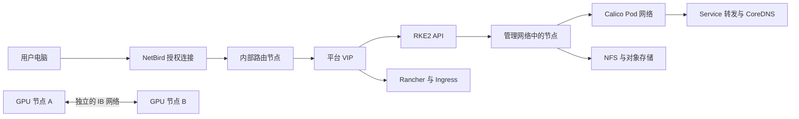
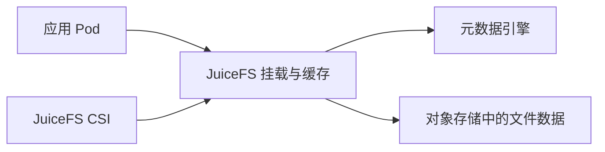

# BBT 平台从零构建：网络、存储、权限、调度、运行与面试

[Kubernetes CI/CD 完整流程：提交、测试、镜像、GitOps、Argo CD 与发布验收](cicd/README.md)。这一章集中解释代码怎样变成集群中的新版本，并提供流水线、候选镜像测试和部署配置。

## 1．项目要建成什么样

实验室有多个课题组，共享 CPU、GPU、存储和网络。学生希望提交程序并拿到结果；导师希望管理本组成员和任务；管理员需要控制总资源、维护服务器并处理故障。

这个平台的建设工作包括：安装 Kubernetes，建立内外部访问路径，准备持久化存储，把用户身份转换为具体权限，为课题组设置资源边界，再接入 Volcano 和 SLURM 两类计算任务。运行以后还需要日志、监控、备份、恢复和操作记录。

每项建设都要回答四个问题：配置保存在哪里；谁使用这项配置；怎样确认配置生效；配置失效时怎样收集证据。

### 1.1 资料依据与复现配置

BBT 技能记录的组件包括 RKE2、Calico、Rancher、Keycloak、NetBird、NFS、JuiceFS、Volcano、Slinky/SLURM、NVIDIA GPU 组件、Multus、InfiniBand SR-IOV，以及 Nexus、OpenResty、Envoy、Step-CA。

技能配套文件可以核对到导师接入、学生绑定、配额、队列创建、SLURM 客户端和分布式训练示例。配套 `onboard-advisor.sh` 使用 `spec.parent: root` 建立课题组队列；默认 ResourceQuota、LimitRange 的具体字段也有文件依据。

本文提供一套独立的复现网络和配置，地址、域名、容量可以在建设前统一修改。它们是用于构建和理解平台的参考配置，生产环境的实际完整清单仍需通过其管理员与配置仓库核实。本次编写没有重新部署 BBT 生产集群。

### 1.2 配套文件怎样使用

所有操作从本目录开始。`config/` 保存配置示例；`charts/` 保存核对版本的 Helm 包；`examples/` 保存可阅读的计算实验；`private/` 由操作者在自己的环境生成，保存在仓库之外。

```bash
mkdir -p work
helm version --short
kubectl version --client
python3 --version
```

从 GitHub 获取源码时，执行 `bash fetch_charts.sh` 下载固定版本的 Helm 包。完整本地资料包已经包含这些 chart，可在目录中执行 `sha256sum -c charts/SHA256SUMS` 核对文件。

在执行任何集群命令前，检查 `kubectl config current-context`。安装、权限和恢复操作由管理员执行，用户学习操作使用自己的 kubeconfig。

## 2．机器、版本和容量规划

### 2.1 复现环境中的机器

| 机器 | 管理地址 | 用途 |
|---|---|---|
| lb1、lb2 | 172.20.10.8、172.20.10.9 | HAProxy 与 Keepalived，提供稳定入口 |
| 入口 VIP | 172.20.10.10 | API 注册、API 请求和平台 HTTPS 入口 |
| cp1、cp2、cp3 | 172.20.10.11～13 | RKE2 控制平面和 etcd |
| g5、g6 | 172.20.10.21～22 | GPU 计算节点，标记 `node-type=gpu` |
| cpu1、cpu2 | 172.20.10.23～24 | CPU 计算节点，标记 `node-type=cpu` |
| storage | 172.20.10.30 | NFS、JuiceFS 元数据和对象存储实验后端 |
| mirrors | 172.20.10.40 | 依赖和镜像缓存 |
| ca | 172.20.10.41 | 内部证书签发服务 |
| dns | 172.20.10.53 | 管理域名解析 |
| NetBird 公网服务器 | 自己持有的公网地址 | 外部设备认证、协调与必要中继 |

控制平面建议为每台预留至少 4 CPU、8 GiB 内存及可靠系统盘。CPU 节点应预留系统与平台组件资源；示例 SLURM NodeSet 每个计算 Pod 请求 4 CPU、8 GiB 内存。GPU 节点需要真实 GPU、兼容驱动与足够主机内存。

资料中的 BBT 使用过在控制平面节点运行 CPU 计算的配置。本文单独安排 CPU 工作节点，便于控制计算任务对 etcd 和 API 的影响。生产设计应记录各类工作负载允许使用的节点。

### 2.2 本文核对的安装版本

| 组件 | 复现版本 | 说明 |
|---|---|---|
| Ubuntu | 24.04 LTS | 本文主机操作命令基于此系统 |
| RKE2 | v1.36.5+rke2r1 | 主 CNI 和网段在首次启动前确定 |
| Calico、Multus、Traefik | 使用 RKE2 配套包 | 记录 RKE2 实际打包版本 |
| Rancher chart | 2.15.2 | chart 的 Kubernetes 上限为 `<1.37`，仍需核对支持矩阵 |
| cert-manager chart | 1.21.3 | 安装 CRD，供证书和 Webhook 使用 |
| NFS provisioner chart | 4.0.18 | 应用版本 4.0.2 |
| JuiceFS CSI chart | 0.33.2 | 需要单独准备元数据与对象存储 |
| GPU Operator chart | v26.7.2 | 需要核对 GPU、内核、驱动和运行环境兼容性 |
| Volcano chart | 1.14.1 | 对应技能中的调度版本 |
| Slinky charts | 1.1.0 | operator-crds、operator、slurm 三个包 |
| SLURM 镜像 | 25.11-ubuntu24.04 | 控制器、计算节点与客户端配套使用 |
| kube-prometheus-stack | 92.14.0 | Prometheus、Grafana、Alertmanager 等 |
| Argo CD chart | 10.11.6 | CI/CD 章节中的 GitOps 部署控制器 |

Helm 能成功渲染，只能证明清单生成完成。内核、GPU 驱动、网络、Webhook、存储及应用运行，还要在目标环境逐项验收。

镜像正式使用时记录 digest。镜像名称加标签容易阅读，digest 用于确认内容。包版本、镜像 digest、配置提交及验证记录共同组成可重复安装所需的信息。

## 3．把五类网络分别规划

| 网络 | 本文配置 | 哪些通信经过这里 |
|---|---|---|
| 管理网络 | 172.20.10.0/24 | 节点管理、API、NFS 和平台内部服务 |
| Pod 网络 | 10.44.0.0/16 | 普通 Pod 与 Pod 之间的通信 |
| Service 网络 | 10.45.0.0/16 | Service 的 ClusterIP 地址 |
| NetBird 覆盖网络 | 由 NetBird 分配 | 外部授权设备到路由节点的连接 |
| IB 网络 | 独立的现场子网 | 训练和 MPI 高速通信 |

建设前同时检查宿主机、虚拟化、Docker、VPN、远端办公网段，避免重叠。Service 地址通常由节点上的转发规则处理，直接在物理网卡上查找该地址可能看不到对应接口。



### 3.1 访问一项服务的实际路径

用户访问 Rancher：浏览器解析域名，流量经过 NetBird 路由节点进入管理网络，连接 VIP 的 443，HAProxy 转发到 Ingress 节点，Traefik 根据域名找到 Rancher Service，Service 再关联 Ready 的 Rancher Pod。

用户执行 kubectl：客户端读取 kubeconfig，根据其中地址连接 API。经过 Rancher 代理的 kubeconfig 还会经过 Rancher 的认证与代理链路；直接管理员 kubeconfig 可以指向 API 入口。最终 API Server 检查请求身份、授权与准入规则。

Pod 访问另一个服务：先查询 CoreDNS，再连接 Service IP，节点转发规则选择后端端点，网络插件负责到达目标 Pod。排查时应分别验证 DNS、端点和实际请求。

### 3.2 防火墙放行清单

| 来源与目标 | 协议/端口 | 用途 |
|---|---|---|
| 授权管理端到入口 | TCP 6443、9345 | API 与 RKE2 注册 |
| 控制平面相互之间 | TCP 2379、2380 | etcd 客户端与成员通信 |
| 控制平面到节点 | TCP 10250 | kubelet API、日志与执行连接 |
| Calico 节点之间 | TCP 179 | BGP 路由交换 |
| 使用 IPIP 的节点之间 | IP 协议号 4 | IPIP 封装流量 |
| 节点到 NFS | TCP 2049 | 本文采用 NFSv4 挂载 |
| 授权客户端到 DNS | UDP/TCP 53 | 域名解析 |
| 用户到平台入口 | TCP 443 | Rancher 与业务 HTTPS |
| SLURM 相关组件 | TCP 6817、6818、6819 | 控制、计算与记账通信 |
| NetBird 公网入口 | 按选定版本开放 | HTTPS、STUN、中继等所需端口 |

端口应限制来源。IB 设备链路、RDMA 与云安全组等规则还需要根据实际网络设备配置。不同网络封装方式需要对应的协议放行。

## 4．安装主机基础环境和 DNS

### 4.1 准备新建的 Ubuntu 节点

设置唯一主机名、静态管理地址、时间同步与系统依赖。`config/node-network.yaml` 是 cp1 的 Netplan 示例，其他机器修改地址和网卡名称后使用。网卡名称通过 `ip -br address` 确认。

```bash
hostnamectl
ip -br address
ip route
timedatectl
sudo apt-get update
sudo apt-get install -y curl ca-certificates nfs-common \
  iptables iproute2 conntrack socat chrony apparmor-utils
sudo systemctl enable --now chrony
```

主机首次配置时关闭 swap，并在系统配置中取消自动启用。检查 `swapon --show`，确认 kubelet 所需的运行前提。将 `overlay`、`br_netfilter` 模块与转发参数写入持久配置，再通过 `sysctl` 验证。

```bash
sudo modprobe overlay
sudo modprobe br_netfilter
sudo sysctl -w net.ipv4.ip_forward=1
sudo sysctl -w net.bridge.bridge-nf-call-iptables=1
sudo sysctl -w net.bridge.bridge-nf-call-ip6tables=1
```

上面的 `sysctl -w` 即时生效。将同名参数保存到 `/etc/sysctl.d/90-bbt.conf`，模块名保存到 `/etc/modules-load.d/bbt.conf`，重启后再检查持久效果。使用文件编辑器保存配置。

### 4.2 建立内部 DNS

在 dns 主机安装 dnsmasq，使用 `config/dnsmasq.conf` 中的记录。安装前检查本机 53 端口占用，确认 dnsmasq 与系统解析服务的监听地址没有冲突。

```bash
sudo apt-get install -y dnsmasq
sudo dnsmasq --test --conf-file=/etc/dnsmasq.conf
sudo systemctl restart dnsmasq
dig @172.20.10.53 api.bbt.example.com
dig @172.20.10.53 storage.bbt.example.com
```

在新建节点的系统网络配置中使用这个 DNS。内部域 `bbt.example.com` 的记录由管理员维护；普通外部域名交给配置的上游解析器。Kubernetes 内部的 Service 域使用 `sspu.local`。

NetBird 需要向远端设备发布适当的 DNS 规则，让内部域使用内部解析器。只配置路由而没有提供正确 DNS 时，可能能够访问 IP，却打不开域名。

## 5．建立 Kubernetes 的稳定入口

在 lb1、lb2 安装 HAProxy 和 Keepalived。使用 `config/haproxy.cfg`，分别处理 6443、9345、443 的 TCP 连接。HAProxy 在本文保持 TLS 透传，证书由 API Server 或 Ingress 提供。

Keepalived 通过两台机器间的状态检测维护 VIP。本文 `config/keepalived.conf` 是 lb1 的配置：网卡为 ens18，源地址 .8，对端 .9，优先级 150。lb2 修改为源地址 .9、对端 .8、优先级 140，使用相同 VRID 和 VIP。

`config/check_haproxy.sh` 放到 `/etc/keepalived/`，设置可执行权限，配合进程检查。网卡名称、单播地址和 VRRP 防火墙规则需要与真实网络匹配。

```bash
sudo apt-get install -y haproxy keepalived
sudo chmod 750 /etc/keepalived/check_haproxy.sh
sudo haproxy -c -f /etc/haproxy/haproxy.cfg
sudo keepalived --config-test -f /etc/keepalived/keepalived.conf
sudo systemctl enable --now haproxy keepalived
ip address show ens18
```

验收时确认 VIP 当前只由一台机器持有。在授权维护测试中停止当前持有者的 Keepalived，确认 VIP 转移，随后恢复服务。连接已经建立的长连接可能中断，客户端需要具有重连能力。

两台负载均衡机器必须处于允许 VIP 漂移的网络环境。云服务器的地址防护策略可能要求使用云负载均衡服务；应在部署前确认基础网络具备相应能力。

## 6．安装三控制平面 RKE2

### 6.1 首个控制平面

将 `config/rke2-server.yaml` 保存为 cp1 的 `/etc/rancher/rke2/config.yaml`。将 `config/rke2-calico-config.yaml` 放到 `/var/lib/rancher/rke2/server/manifests/`，在首次启动前准备完成。

配置中固定了节点管理 IP、Pod 和 Service 网段、集群域、CNI 与入口 SAN。`secrets-encryption-provider: aescbc` 指定 Secret 的静态加密方式；读取 Secret 的 API 权限仍然需要单独控制。

```bash
mkdir -p work
curl --fail --location https://get.rke2.io --output work/install-rke2.sh
less work/install-rke2.sh
sudo env INSTALL_RKE2_VERSION=v1.36.5+rke2r1 \
  INSTALL_RKE2_TYPE=server sh work/install-rke2.sh
sudo systemctl enable --now rke2-server
sudo journalctl -u rke2-server --no-pager -n 100
```

控制平面启动后产生 kubeconfig 和加入令牌。管理员通过受保护的连接把令牌分发到其他节点的 `/etc/rancher/rke2/join-token`，设置 root 所有和 0600 权限。令牌不进入代码仓库和部署日志。

### 6.2 另外两个控制平面

cp2、cp3 使用相同的集群级参数，分别修改 `node-name`、`node-ip`、`advertise-address`，并增加：

```yaml
server: https://api.bbt.example.com:9345
token-file: /etc/rancher/rke2/join-token
```

同版本安装 server 服务后启动。Pod CIDR、Service CIDR、集群域和 CNI 等关键配置保持一致。系统启动后检查节点 Ready 和 etcd 成员状态。

### 6.3 工作节点

g5、g6 使用 `config/rke2-agent.yaml`，分别修改名称和管理地址。cpu1、cpu2 使用同样方式，把 `node-type` 标签改为 `cpu`。

```bash
sudo env INSTALL_RKE2_VERSION=v1.36.5+rke2r1 \
  INSTALL_RKE2_TYPE=agent sh work/install-rke2.sh
sudo systemctl enable --now rke2-agent
sudo journalctl -u rke2-agent --no-pager -n 100
```

所有节点的安装版本保持一致，安装源可以通过经过校验的离线包提供。部署到受限网络时，提前准备二进制、镜像和校验文件。

### 6.4 集群验收

在控制平面管理员终端执行：

```bash
export PATH=/var/lib/rancher/rke2/bin:$PATH
export KUBECONFIG=/etc/rancher/rke2/rke2.yaml
kubectl get nodes -o wide
kubectl get pods -A
kubectl get --raw='/readyz?verbose'
kubectl get helmchart -n kube-system
kubectl get installation.operator.tigera.io default -o yaml
```

检查节点数量、管理 IP、CNI 状态和 API 健康。再用位于不同节点的测试 Pod 验证直接 Pod 通信、DNS、ClusterIP 与实际 HTTP 请求。节点 Ready 之后仍然需要这些网络测试。

## 7．Calico：路由、网卡选择与跨节点通信

### 7.1 多网卡环境为什么容易出错

一台 GPU 节点可能同时具有管理网卡、NetBird 虚拟网卡、IB 网卡和容器接口。Calico 需要选择正确的地址建立节点间路由关系。

BBT 的历史故障资料记录：自动检测选用了 NetBird 或 IB 地址，BGP 对端使用管理地址，源地址不一致导致连接被拒绝。最后表现为跨节点 Pod 不通、CoreDNS 连接 API 超时和 Rancher agent 异常。

本文在安装配置中明确指定 `nodeAddressAutodetectionV4.cidrs=[172.20.10.0/24]`，让地址选择符合管理网络规划。首次安装便准备这个配置，可减少多网卡自动选择的不确定性。

### 7.2 BGP 与 IPIP 分别做什么

BGP 交换“到目标 Pod 网段应经过哪台节点”的路由。IPIP 负责在需要的节点链路上封装数据包。`IPIPCrossSubnet` 根据节点所属子网决定是否封装；底层网络仍然需要允许相应协议并正确转发。

本文 Pod 网段采用 /26 分配块，一个 /26 包含 64 个地址；它描述 IPAM 分配单位，不能直接代替每节点最大 Pod 数和实际可用数量的计算。

MTU 描述能够在链路上传送的数据包尺寸。隧道头部会占用空间；路径 MTU 不匹配可能表现为小请求正常，大文件或某些 TLS 请求失败。配置 1480 后仍要结合真实链路验证。

### 7.3 配置路由反射器

路由反射器帮助转发 BGP 路由信息，减少节点之间建立完整连接关系的数量。本文指定 cp1、cp2 为反射器。

先在已有节点网络可用时配置标记和反射器属性，确认管理地址正确，再应用 `config/calico-bgp.yaml` 切换 BGP 对等关系：

```bash
kubectl label node cp1 cp2 route-reflector=true
kubectl patch nodes.crd.projectcalico.org cp1 --type=merge \
  -p '{"spec":{"bgp":{"routeReflectorClusterID":"244.0.0.1"}}}'
kubectl patch nodes.crd.projectcalico.org cp2 --type=merge \
  -p '{"spec":{"bgp":{"routeReflectorClusterID":"244.0.0.1"}}}'
kubectl apply -f config/calico-bgp.yaml
kubectl get bgppeers.crd.projectcalico.org
kubectl get bgpconfigurations.crd.projectcalico.org default -o yaml
```

应用配置前应确认目标版本的 Calico CRD 名称和字段。所有节点应具备通向反射器的 TCP 179 路径；反射器相互也需要建立会话。

查看 calico-node 日志、BIRD 路由、主机路由及实际跨节点请求。修改 CNI 所属资源时通过 HelmChartConfig 或 operator 管理对象，避免直接修改随后会被控制器覆盖的生成结果。

## 8．NetBird：让校外设备进入管理网络

### 8.1 公网控制服务与内部路由节点

公网服务器负责设备登录、协调和必要中继。内部路由节点同时能够访问 NetBird 网络与管理网络，向获准设备提供指定内部网段的路径。

认证服务需要在设备尚未加入 VPN 时可访问，否则无法完成首次登录。公网域名、HTTPS、反向代理、身份系统回调和防火墙需要共同可用。

NetBird 的安装文件随版本变化。使用官方自托管安装脚本时，将选定发行版本的 `getting-started.sh` 下载到 `work/`，检查脚本后运行，记录脚本 SHA256、容器版本及生成配置。官方页面提供当前安装入口和生成文件说明。

```bash
mkdir -p work
curl --fail --location \
  https://github.com/netbirdio/netbird/releases/latest/download/getting-started.sh \
  --output work/netbird-getting-started.sh
shasum -a 256 work/netbird-getting-started.sh
less work/netbird-getting-started.sh
bash work/netbird-getting-started.sh
```

上面的 latest 是获取脚本的入口；复现归档必须保留这次下载文件和实际解析的版本，后续使用归档文件及固定镜像。安装时填写自己持有的公网域名，准备该版本要求的端口与证书条件。

### 8.2 发布管理网段

在 NetBird 控制台建立内部网络，填写管理网段 `172.20.10.0/24`，选择已加入的内部路由节点，关联允许访问的用户或设备组。路由节点需启用 IP 转发，按环境选择源地址伪装或配置回程路由。

源地址伪装使内部服务看到路由节点的地址；保留客户端源地址则有利于部分审计场景，但内部网络需要知道返回路径。选择后应记录防火墙规则及日志中实际看到的来源地址。

给内部域配置 NetBird DNS 规则，指向 `172.20.10.53`。验证用户能够解析 Rancher 域名，并能连接对应 TCP 443。

### 8.3 四项独立验证

```bash
netbird status
dig rancher.bbt.example.com
curl --connect-timeout 10 --max-time 20 -I https://rancher.bbt.example.com
kubectl --request-timeout=10s -n 自己的命名空间 get pods
```

四项分别涉及 VPN 状态、DNS、HTTPS 和 Kubernetes 身份权限。`LoginFailed`、TLS 握手失败、DNS 错误和 API Forbidden 需要沿各自路径检查。

身份过期需要重新认证，过期的 kubeconfig 需要更新对应凭据，Rancher API Key 需要能够到达服务器才能使用。它们属于不同配置和状态，不能通过替换任意一个文件统一解决。

## 9．内部 CA、镜像缓存与依赖访问

### 9.1 证书链怎样影响访问

TLS 客户端检查证书信任链、域名、有效期和服务器证明。内部 CA 可以为 Rancher、镜像仓库等内部服务签发证书。客户端应信任正确的根证书，并通过完整证书链访问目标服务。

Step-CA 用于管理签发流程。根私钥应离线或受到独立保护，在线签发服务使用受控的中间 CA。用户可以获得根证书，私钥由签发系统保管。用 `step ca certificate 服务域名 server.crt server.key` 获取服务证书时，使用已初始化并配置授权方式的 Step-CA 客户端。

```bash
openssl x509 -in private/server.crt -noout -subject -issuer -dates
openssl x509 -in private/server.crt -noout -ext subjectAltName
curl --cacert private/root-ca.crt -I https://rancher.bbt.example.com
```

### 9.2 Nexus 缓存保存什么

Nexus 的 Docker、PyPI、Maven、npm 等代理仓库保存对应格式的制品。首次请求可能访问上游，后续命中缓存的请求从内部返回。仓库类型、上游地址和认证方式必须匹配。

建设步骤：安装并记录 Nexus 镜像 digest，挂载独立持久化目录，在 UI 创建需要的 proxy 仓库，设置正确的上游 URL，配置受控的下载账号和仓库权限，再用真实制品测试首次下载和缓存命中。

Nexus 数据目录需要与镜像运行用户权限匹配。定期备份配置、数据库及 blob store，检查磁盘容量和清理策略。仓库启动不代表每个代理格式已经可用。

### 9.3 OpenResty 与 Envoy 的位置

OpenResty 根据域名或路径把请求送到内部仓库，并可终止 TLS。Envoy 可以承担需要继续访问真实上游的连接代理。BBT 资料中既有显式仓库地址，也有受控 DNS 重定向的依赖访问方式。

复现时优先给客户端配置明确的内部仓库地址。采用域名重定向时，需要管理域名解析、证书授权和上游路由，防止缓存服务再次把上游请求解析回自己形成循环。

```nginx
server {
    listen 443 ssl;
    server_name mirrors.bbt.example.com;
    ssl_certificate /etc/openresty/tls/fullchain.crt;
    ssl_certificate_key /etc/openresty/tls/server.key;
    client_max_body_size 2g;
    location /repository/ {
        proxy_set_header Host $host;
        proxy_set_header X-Forwarded-Proto https;
        proxy_read_timeout 300s;
        proxy_pass http://127.0.0.1:8081;
    }
}
```

该片段公开 Nexus 的 repository 路径，Nexus 管理页面可通过独立授权入口访问。Docker 仓库还需按所选仓库 connector 的端口和认证要求配置。

### 9.4 配置 RKE2 私有仓库

节点在 `/etc/rancher/rke2/registries.yaml` 中设置镜像 endpoint、认证和 CA 路径。下面是结构示例，认证值从私有配置填入：

```yaml
mirrors:
  docker.io:
    endpoint:
      - https://registry.bbt.example.com
configs:
  registry.bbt.example.com:
    auth:
      username: 填写仓库专用账号
      password: 从私有配置提供
    tls:
      ca_file: /etc/rancher/rke2/certs/registry-ca.crt
```

实际拉取时检查完整镜像名、标签或 digest、registry challenge、证书与凭据。通过节点 containerd 实际拉取，再通过测试 Pod 拉取，确认两条操作路径均正常。

### 9.5 代理范围与内部直连

下载外部依赖所需的代理应限定在对应工具或服务，内部 API、Service、Pod、NFS 与 OIDC 回调不应被意外送到外部代理。配置服务代理时，同时设置与实际网络匹配的 `NO_PROXY`，例如：

```text
NO_PROXY=localhost,127.0.0.1,172.20.10.0/24,10.44.0.0/16,10.45.0.0/16,.sspu.local,.bbt.example.com
```

不同工具对 CIDR、域名后缀和大小写环境变量的处理可能不同。分别测试 curl、容器运行环境和应用使用的 HTTP 库，确认内部目标实际走了预期路径。

## 10．建立 NFS 工作空间

### 10.1 服务端目录和导出规则

在 storage 主机执行：

```bash
sudo apt-get install -y nfs-kernel-server
sudo install -d -o 1000 -g 1000 -m 2770 /exports/bbt
```

将 `config/nfs.exports` 作为 `/etc/exports.d/bbt.exports`。本例限制管理网段访问，启用同步写入与 root_squash，并将被映射的匿名身份设为 1000，便于学习环境中的目录供给。

```bash
sudo exportfs -ra
sudo exportfs -v
sudo systemctl enable --now nfs-kernel-server
```

这是共享课题组目录的复现权限配置。生产环境需要核对服务端 ACL、用户 UID/GID、节点信任、数据所有权和租户目录边界。NFS AUTH_SYS 信任客户端提交的身份信息，节点与容器权限必须受到约束。

### 10.2 安装目录供给控制器

本文使用与技能中 `nfs-client` 对应的 nfs-subdir-external-provisioner。配置见 `config/nfs-values.yaml`：

```bash
helm upgrade --install nfs charts/nfs-subdir-external-provisioner-4.0.18.tgz \
  -n nfs-provisioner --create-namespace -f config/nfs-values.yaml --wait --timeout 5m
kubectl get storageclass nfs-client -o yaml
kubectl -n nfs-provisioner get pods
```

控制器在 NFS 导出中为 PVC 建立目录，`pathPattern` 采用 `命名空间/PVC名称`。它不需要为每个 PVC 新建独立 NFS 服务器。

Retain 和目录归档策略共同影响回收。删除 PVC 后，底层目录和数据是否保留，要结合 PV 状态、provisioner 行为和配置验证。不要把删除命名空间作为数据清理的全部流程。

### 10.3 PVC 与卷权限

```yaml
apiVersion: v1
kind: PersistentVolumeClaim
metadata:
  name: workspace-pvc
  namespace: advisor-zhangsan
spec:
  storageClassName: nfs-client
  accessModes: [ReadWriteMany]
  resources:
    requests:
      storage: 10Gi
```

Pod 使用 `persistentVolumeClaim.claimName` 挂载此申请，通常使用 `/workspace`。数据位于服务端 `/exports/bbt/advisor-zhangsan/workspace-pvc`。

PVC 的容量申请参与 Kubernetes 配额检查。目录型 NFS 供给方式的真实空间限制，需要服务端文件系统或配额机制保证。扩容字段获准修改，也要继续验证服务端限制与使用结果。

## 11．建立 JuiceFS 大文件存储

### 11.1 元数据与文件内容分别放在哪里

JuiceFS 的元数据引擎保存目录、文件属性和数据块索引，对象存储保存文件内容。客户端协调访问元数据与对象数据，并使用本地缓存。CSI 负责把这个文件系统交给 Kubernetes Pod。



缺少元数据可能导致对象块无法按原目录访问；只备份元数据也不能替代文件对象备份。需要保护两部分及恢复所需的访问材料。

### 11.2 准备实验后端

`config/storage-compose.yaml` 提供 Redis 与 SeaweedFS S3 的独立学习部署。Redis 开启 AOF，服务数据挂载到持久目录；单机后端属于单机故障范围，不能作为多机高可用证明。

在配套目录首次执行：

```bash
python3 create_private_files.py
python3 -m venv work/tools-venv
source work/tools-venv/bin/activate
python -m pip install -r requirements-tools.txt
```

通过受保护的连接把 Compose 文件和所需私有文件复制到 storage 的独立安装目录。Compose 中的相对目录依据安装目录安排，把配置保存为该目录的 `compose.yaml`，同时保留 `private/`。

```bash
docker compose --env-file private/backend.env config --quiet
docker compose --env-file private/backend.env up -d
docker compose ps
python create_bucket.py
```

`create_bucket.py` 真实创建 bucket 并验证写入和读取。脚本从私有 JSON 读取认证信息，不把认证信息打印到终端。已有后端使用自己的初始化和验证流程，避免重复初始化覆盖数据。

### 11.3 安装 CSI 并创建存储类型

回到管理员终端：

```bash
kubectl apply -f private/juicefs-secret.json
helm upgrade --install juicefs charts/juicefs-csi-driver-0.33.2.tgz \
  -n kube-system -f config/juicefs-values.yaml --wait --timeout 5m
kubectl apply -f config/juicefs-storageclass.yaml
kubectl get csidriver csi.juicefs.com
```

Secret 包含文件系统名称、元数据地址、对象存储类型、bucket 及认证材料。将 PVC 的 storageClassName 设为 `juicefs-sc`，通过实际写读和新 Pod 挂载验证。

Redis 6379 和 S3 8333 在本例仅对管理网段开放。生产部署需要认证、访问范围、传输保护、元数据高可用及对象存储可靠性设计。默认缓存容量也要计入节点磁盘预算。

### 11.4 NFS 与 JuiceFS 怎样分工

代码、依赖环境和大量小文件使用技能中推荐的 NFS 工作空间。大数据集和模型文件可以按访问模式评估 JuiceFS。使用真实数据测试文件创建、随机读取、顺序吞吐和并发行为，记录缓存条件。

存储选择应根据实际工作负载。只用一个大文件的顺序读结果，无法推断 Python 虚拟环境等大量小文件的表现。

## 12．部署 Rancher 与统一身份

### 12.1 安装证书组件和 Rancher

```bash
helm upgrade --install cert-manager charts/cert-manager-1.21.3.tgz \
  -n cert-manager --create-namespace --set crds.enabled=true --wait --timeout 5m
kubectl create namespace cattle-system
kubectl -n cattle-system create secret tls tls-rancher-ingress \
  --cert=private/rancher-fullchain.crt --key=private/rancher.key
kubectl -n cattle-system create secret generic tls-ca \
  --from-file=cacerts.pem=private/ca-chain.pem
helm upgrade --install rancher charts/rancher-2.15.2.tgz \
  -n cattle-system -f config/rancher-values.yaml --wait --timeout 10m
kubectl -n cattle-system rollout status deployment/rancher --timeout=300s
```

证书 SAN 应包含 `rancher.bbt.example.com`。私有 CA 模式需要提供正确的 CA 链。浏览器、Rancher agent 和后端访问方都要建立正确的信任关系。

完成初始化管理员设置后，建立项目、用户登录与课题组管理流程。保留受保护的独立管理员访问方式，防止身份系统故障时无法维护集群。

### 12.2 配置 Keycloak/OIDC

身份系统需要独立持久化数据库、备份和稳定 HTTPS 地址。使用官方 Keycloak 发行版时，固定版本，配置 PostgreSQL 等受支持数据库，按反向代理方式设置 hostname 与代理头，完成 HTTPS 及健康检查后再配置客户端。

配套 `config/identity-compose.yaml` 使用 Keycloak 26.4.0 与 PostgreSQL 17.6。把它保存到独立身份服务器的安装目录，准备 `private/identity.env`，使用 `config/identity-nginx.conf` 配置该机器的 HTTPS 反向代理。`auth.bbt.example.com` 在本文代表自己持有且可从所需网络访问的身份域名，证书包含该名称。

```bash
docker compose --env-file private/identity.env -f identity-compose.yaml config --quiet
docker compose --env-file private/identity.env -f identity-compose.yaml up -d
curl --fail https://auth.bbt.example.com/realms/bbt/.well-known/openid-configuration
```

最后一个命令在创建 `bbt` realm 之后验证 discovery。首次使用私有文件中的管理员密码登录，建立正式管理账号，记录配置、启用所需的登录保护并备份数据库。

在 Keycloak 创建 BBT realm，配置用户或外部用户目录，分别为 Rancher 与 NetBird 建立客户端。记录下面字段：

| 字段 | 需要核对的内容 |
|---|---|
| Issuer | 与 discovery 返回值完全一致，包含 realm 路径 |
| Client ID | 当前接入应用的专用客户端标识 |
| Client 类型 | 按应用要求选择 confidential 或 public/PKCE |
| Redirect URI | 与应用显示的回调地址严格匹配 |
| Scopes 与 claims | openid、profile、email，以及实际使用的组信息 |
| Logout 与会话期限 | 用户退出、登录过期和设备会话的关系 |
| Client Secret | 仅供需要它的后端应用使用，私有保存 |

Rancher 的认证设置按所选 OIDC provider 填写 issuer、client 及回调信息。NetBird 按其固定版本的外部身份提供方设置接入同一身份系统。两者各自的客户端配置保持独立。

Rancher 客户端可以命名为 `rancher`，启用 Client authentication，Redirect URI 使用 `https://rancher.bbt.example.com/verify-auth`。按该版本的 Keycloak OIDC 配置说明设置 `groups`、audience 和所需用户字段映射，再验证真实登录身份与组信息。

使用内嵌身份服务的 NetBird 版本时，在 Dashboard 的 Settings → Identity Providers 添加 Generic OIDC，填写专用 confidential client、Secret 和 `https://auth.bbt.example.com/realms/bbt`。保存后，把页面生成的准确 Redirect URL 注册到 Keycloak，随后测试登录与退出。回调地址中的 connector 标识由平台生成。

技能没有附带完整的生产 Keycloak realm 导出和 NetBird 服务端配置，因此生产认证参数需由管理员取得，不能通过域名猜测。本文给出的字段清单用于完成复现配置与验收。

验证 discovery、授权跳转、回调、用户映射、正常退出和过期重登。不要仅以“能打开登录页”判定 SSO 完成。

## 13．建立导师、学生与管理员权限

### 13.1 RBAC 对象的关系

认证回答“请求者是谁”，授权回答“允许请求者做什么”。ClusterRole 描述规则，RoleBinding 将这些规则在指定命名空间授予一个实际身份。

BBT 技能中使用 `namespace-admin`、`namespace-user`。本文提供名称带 `bbt-` 前缀的复现角色，避免覆盖目标集群已有角色定义。

```bash
kubectl apply -f config/rbac.yaml
```

规则按 apiGroup 分开。Pod 位于核心组，Deployment 位于 apps，普通 Job 位于 batch，Volcano Job 位于 batch.volcano.sh。同一个规则中的 apiGroups 与 resources 会组合匹配，混写容易产生无效或意外规则。

### 13.2 创建课题组

用编辑器把 `config/tenant.yaml` 中的导师和学生身份替换为认证后真实的用户标识，保留资源名称及命名空间关系。然后由管理员执行：

```bash
kubectl apply -f config/tenant.yaml
kubectl -n advisor-zhangsan get rolebindings
kubectl -n advisor-zhangsan describe resourcequota
kubectl -n advisor-zhangsan describe limitrange
```

导师可以管理本组工作负载、配置和 LimitRange；ResourceQuota 只读。学生可以创建和观察作业，计算任务删除由导师处理。角色定义没有授予修改集群节点和 ClusterRole 的权限。

本文把学生 RoleBinding 的创建交由管理员或受控接入服务执行。生产若允许导师直接绑定学生角色，还需精确限制 bind 权限和绑定对象，避免获得任意角色管理能力。RBAC 无法仅靠 `student-*` 名称前缀自动限制创建对象。

### 13.3 怎样验证真实权限

分别使用导师、学生和管理员 kubeconfig 执行权限检查，并用服务端 dry-run 验证实际请求。管理员模拟用户时，需要具有 impersonate 权限。

```bash
kubectl auth can-i create jobs.batch.volcano.sh -n advisor-zhangsan
kubectl auth can-i delete jobs.batch.volcano.sh -n advisor-zhangsan
kubectl auth can-i update resourcequotas -n advisor-zhangsan
kubectl create --dry-run=server -n advisor-zhangsan -f examples/cpu-job.yaml
```

请求失败时记录使用的身份、资源、动词、命名空间和完整原因。来自 Rancher 代理的身份，需要沿用户实际使用的 kubeconfig 验证，避免把管理员身份的结果当作学生权限结果。

### 13.4 权限隔离的实际边界

课题组成员共用一个命名空间，意味着它们处于同一个管理范围。具有创建 Pod 权限的用户可能通过 Pod 使用本命名空间的卷和服务账号，Secret 的直接读取权限并不能概括全部数据访问能力。

需要学生之间进一步隔离时，增加独立命名空间、受控服务账号、卷访问策略和准入约束。授予权限之前确定所需的隔离粒度，并通过访问测试验证。

## 14．资源配额、运行约束和网络策略

### 14.1 三层资源约束

容器 requests 参与调度申请；limits 对运行资源施加限制；ResourceQuota 对命名空间累计请求和对象数量施加上限。LimitRange 为未填写的字段提供默认值，并检查单对象边界与比例。

默认配额中 requests.cpu 为 16。七个容器各请求 2 CPU，累计 14；新任务请求 4 CPU 时会达到 18。CPU 利用率低仍然可能遇到请求总量不足。

示例同时设置总存储 200Gi、NFS 分类 200Gi 和 JuiceFS 分类 500Gi。所有限制共同生效，所以总存储仍然是 200Gi。扩容课题组时需要同时核对 ResourceQuota、LimitRange、队列和实际物理容量。

### 14.2 Pod 运行权限

`tenant.yaml` 为普通学习命名空间启用 restricted Pod Security。示例 Job 使用非 root 用户、禁止提权、丢弃多余 capabilities、使用默认 seccomp，并避免宿主机路径挂载。

GPU、IB、SLURM 基础设施可能需要特定设备、capability 或宿主机访问。应由管理员在独立受控范围配置必要权限，并验证所需设备路径。要求 IPC_LOCK 或 hostPath 的分布式模板，不能直接放入本文 restricted 命名空间后期待自动运行。

### 14.3 网络访问规则

```bash
kubectl apply -f config/networkpolicy.yaml
kubectl -n advisor-zhangsan get networkpolicy
```

规则默认限制进出流量，放行本组 Pod、CoreDNS、规定的存储端口和监控入口。业务访问其他服务时，增加对应目标和端口规则。

NetworkPolicy 需要网络插件实际实施。节点上的镜像拉取、kubelet 挂载和部分宿主机流量，不等同于应用 Pod 的受控流量。Multus 额外网卡、RDMA 数据路径也需要独立核对策略覆盖范围。

## 15．部署 Volcano 并约束课题组队列

```bash
helm upgrade --install volcano charts/volcano-1.14.1.tgz \
  -n volcano-system --create-namespace -f config/volcano-values.yaml \
  --wait --timeout 5m
kubectl apply -f config/priorityclasses.yaml
kubectl apply -f config/queues.yaml
kubectl apply -f config/queue-admission.yaml
kubectl -n volcano-system get pods
kubectl get queues.scheduling.volcano.sh
```

队列示例的 root capability 为 96 CPU、192Gi 内存、16 个 GPU 资源单位。它属于复现容量，应用前要根据全部节点的 allocatable、SLURM 已预留量及平台开销调整，尤其要检查 GPU、网卡等扩展资源维度。

### 15.1 调度参数的含义

| 字段 | 含义与限制 |
|---|---|
| `queue` | 任务所属队列，需要提交授权校验 |
| `minAvailable` | 成组调度所需最少 Pod 数量 |
| `capability` | 队列资源上限，仍受父队列和物理容量约束 |
| `weight` | 参与相应插件的资源份额计算 |
| `priorityClassName` | 任务的优先级输入，效果取决于调度策略 |
| `reclaimable` | 与相关回收策略配合使用 |

配置中的 `enqueue, allocate, backfill` 与所列插件完成任务准入、节点选择和可用资源安排。是否能够回收或抢占，要同时检查 actions、插件和策略。本文优先级对象使用 `preemptionPolicy: Never`，不把更高的数值解释为已经启用抢占。

### 15.2 防止使用其他课题组队列

Queue 是集群级资源，namespace 是命名空间级资源。仅按名字建队列，不会自动阻止用户在任务中填写其他队列。

`queue-admission.yaml` 使用 ValidatingAdmissionPolicy 检查带租户标签的命名空间：CPU 任务只能使用同名 CPU 队列；请求 GPU 的任务使用本组 `-gpu` 队列；PriorityClass 限制在批准列表中。

额外需要通过准入策略控制直接 Pod 请求 GPU、额外调度器、服务账号和其他资源入口。完整的租户测试应覆盖每种允许创建的对象，避免只验证 Volcano Job 一种路径。

### 15.3 成组调度的实际含义

两个 Pod 各申请八张 GPU，`minAvailable: 2` 表示这两个 Pod 的成组要求。它与训练进程总数分开计算。成组安排不会让镜像拉取、容器启动和程序初始化在完全相同的瞬间完成。

通过 Job、PodGroup、事件、队列已分配量和程序日志共同检查。资源不足时保留成组要求，先理解排队原因，再按真实任务需求调整配置。

## 16．把 GPU 交给计算任务

### 16.1 节点软件与容器软件

节点需要能够驱动物理 GPU；设备插件向 Kubernetes 报告资源；容器运行配置允许将设备与所需库提供给获配容器；镜像中的框架还需要支持目标 GPU 架构。

GPU Operator 管理其中多项组件。安装前确认主机驱动是否由其他系统管理，避免两套驱动管理同时修改节点。本例由 Operator 管理驱动。

```bash
helm upgrade --install gpu-operator charts/gpu-operator-v26.7.2.tgz \
  -n gpu-operator --create-namespace -f config/gpu-values.yaml \
  --wait --timeout 15m
kubectl -n gpu-operator get pods -o wide
kubectl describe node g5
```

`gpu-values.yaml` 指定 RKE2 的 containerd 配置和 socket 路径。containerd 版本、CDI 配置及 toolkit 操作需要结合节点实际生成的配置验证，后续 RKE2 重启后也需要复查。

### 16.2 三项验收

第一项：主机 `nvidia-smi` 正常，检查型号、驱动和设备数量。第二项：Node 的 allocatable 中有正确的 `nvidia.com/gpu`。第三项：获配 GPU 的测试 Pod 可以通过框架完成真实计算。

```yaml
resources:
  requests:
    cpu: "2"
    memory: 4Gi
    nvidia.com/gpu: "1"
  limits:
    cpu: "4"
    memory: 8Gi
    nvidia.com/gpu: "1"
```

一个资源单位具体代表整卡、切片还是共享份额，取决于设备插件配置。记录节点共享策略，避免把不同 Pod 显示的相同物理 GPU 重复计算成多张独占卡。

### 16.3 分布式训练

DDP 为各训练进程准备模型副本，通过通信同步梯度。FSDP 按策略分布模型参数、梯度与优化器状态，减少部分单卡内存需求，同时增加通信和恢复复杂度。

为每次任务记录镜像、代码提交、模型、数据、进程数量、并行方式、batch、精度和通信环境。Checkpoint 应包含恢复需要的模型、优化器、进度及随机状态，并经过恢复验证。

## 17．Multus、SR-IOV 与 InfiniBand

### 17.1 为什么需要第二张 Pod 网卡

Calico 提供普通 Pod 网络。Multus 协调额外网络附件，让训练 Pod 保留默认网络，同时获得高速通信接口。SR-IOV 将网卡提供的 VF 分配给 Pod，设备插件报告资源，CNI 完成接口配置。

IB 子网需要正确的链路状态、子网管理、设备身份和地址管理。BBT 资料中的核心条件包括 OpenSM、非零且唯一的 VF GUID、允许的 VF 状态和正确的 IPAM。

### 17.2 配置顺序

1. 确认硬件、BIOS、IOMMU、网卡固件和驱动支持。
2. 检查 PF 端口与 IB 交换网络，确认子网管理服务工作。
3. 为节点配置 VF 数量、唯一 GUID 和可用链路状态。
4. 配置随驱动就绪后运行的持久化初始化服务。
5. 安装并核对相应设备插件、ib-sriov CNI 与 IPAM。
6. 建立实际地址池，避免不同节点分配重复 IP。
7. 应用 `config/ib-network.yaml`，在任务中请求匹配的设备资源。

`ib-network.yaml` 引用了 `nv-ipam` 与 `sriov-ib-pool`。应用前必须已经存在与部署版本匹配的 nv-ipam 组件和地址池；这份附件配置本身不会安装这些组件。

配套技能提供特定 ConnectX 设备的 VF 示例。VF 数量、GUID 前缀、网卡名和 PCI 地址属于硬件相关配置，应从自己的设备读取，维护窗口内完成配置和验收。

### 17.3 训练 Pod 的关键字段

```yaml
metadata:
  annotations:
    k8s.v1.cni.cncf.io/networks: sriov-ib-network
spec:
  containers:
    - name: worker
      resources:
        requests:
          nvidia.com/mlnxnics: "1"
        limits:
          nvidia.com/mlnxnics: "1"
```

只有在镜像、驱动和通信库确实需要时，按审核规则授予 IPC_LOCK 等权限。NAD 所在命名空间和引用范围要匹配任务。

### 17.4 怎样证明 RDMA 生效

检查 Pod 的 `net1`、分配到的 RDMA 设备、IB 端口状态、实际带宽测试和 NCCL 日志。为通信库选择本次分配的具体设备，避免匹配整台机器上的所有网卡。

IPoIB 可以 ping 通，说明相应 IP 路径有响应；RDMA、GPUDirect 和实际训练吞吐，需要各自的设备、软件与性能证据。

## 18．部署 SLURM、记账数据库与 CPU 计算节点

### 18.1 先安装 CRD 和 Operator

```bash
helm upgrade --install slurm-operator-crds charts/slurm-operator-crds-1.1.0.tgz
helm upgrade --install slurm-operator charts/slurm-operator-1.1.0.tgz \
  -n slinky --create-namespace --wait --timeout 5m
kubectl create namespace slurm
kubectl apply -f config/slurm-storage.yaml
kubectl apply -f private/mariadb-secret.json
kubectl apply -f config/mariadb.yaml
kubectl -n slurm rollout status statefulset/mariadb --timeout=300s
```

cert-manager 应已运行。数据库 Secret 由 `create_private_files.py` 生成，使用独立账号保存记账数据。本例 MariaDB 使用单副本持久卷；业务等级需要更高可靠性时，应使用匹配的数据库高可用与备份方案。

安装前在 cpu1 准备 `/var/lib/bbt-state/slurm`，按所选 slurmctld 镜像的实际运行 UID/GID 设置所有权；在 cpu2 准备 `/var/lib/bbt-state/mariadb`，设置所有者 1000:1000 和权限 2770。Local PV 将各状态卷绑定到相应节点，节点故障时需要按备份和数据位置进行恢复。

### 18.2 安装控制器与计算 NodeSet

```bash
helm upgrade --install slurm charts/slurm-1.1.0.tgz \
  -n slurm -f config/slurm-values.yaml --wait --timeout 10m
kubectl apply -f config/slurm-nodeset.yaml
kubectl -n slurm get controllers.slinky.slurm.net
kubectl -n slurm get nodesets.slinky.slurm.net
kubectl -n slurm get pods
```

slurmctld 管理任务与分配，slurmd 执行计算。NodeSet 让 Operator 管理计算 Pod、副本和对应分区。Controller 状态卷保存任务管理状态；slurmdbd 与 MariaDB 保存记账信息。

NodeSet 的每个计算 Pod 在 Kubernetes 中明确请求和限制 4 CPU、8Gi 内存。SLURM 可分配资源必须与其容器实际资源匹配。增加 NodeSet 副本可以增加计算位置，底层 Kubernetes 节点仍要具有对应资源。

### 18.3 解决提交与计算路径一致的问题

提交容器可以读取脚本，计算容器也必须能够读取脚本、程序和输出目录。本文为控制器及 slurmd 挂载 NFS 根目录到 `/shared`。

课题组 PVC 的实际服务端目录是 `命名空间/PVC名称`。用户客户端可以把自己的 PVC 挂到 `/shared/advisor-zhangsan/workspace-pvc`，使同一份文件在提交端和计算端具有相同绝对路径。

如果提交端使用 `/workspace`，而计算端只有 `/shared`，`sbatch` 成功后仍然可能遇到工作目录或程序路径不存在。这个问题需要统一路径规则，不能仅检查 PVC 是否 Bound。

### 18.4 SLURM 认证与账号映射

`auth/slurm`、`auth/munge` 和 JWT 具有不同的配置要求。控制器、计算节点、客户端及 REST API 使用的方式必须匹配。共享认证材料、客户端认证守护进程、Linux UID/GID、SLURM 用户和 account 都要核对。

本地技能中的客户端文件存在不同认证配置记录，完整生产部署应以实际 Controller、镜像和客户端认证链路核验。不要仅根据某个 Secret 名称判断当前认证方式。

使用 `auth/slurm` 的登录节点通常通过 `sackd` 提供本地认证与配置获取。Slinky 的 LoginSet 提供登录节点管理能力，结合 SSSD 或统一用户目录维护真实 UID/GID；启用时需要准备相应目录服务配置、登录凭据与共享路径。临时提交容器也要满足同样的认证前提。

管理员使用经过认证的客户端执行 `sinfo`、`squeue`，建立课题组 account 和实际用户关联，再验证用户提交。普通用户的入口应通过受控的登录客户端或认证网关提供，避免赋予任意访问控制器容器的权限。

### 18.5 计算与记账验收

```bash
kubectl -n slurm exec slurm-controller-0 -c slurmctld -- sinfo
kubectl -n slurm exec slurm-controller-0 -c slurmctld -- scontrol show nodes
kubectl -n slurm exec slurm-controller-0 -c slurmctld -- sacctmgr show account
kubectl -n slurm exec slurm-controller-0 -c slurmctld -- squeue
```

在授权客户端提交一个调用 `srun hostname` 的小任务，记录返回编号，检查实际运行节点、退出码、输出文件与 `sacct` 记录。Kubernetes 提交 Job 完成、sbatch 接受、SLURM 计算完成是三个需要分别确认的结果。

### 18.6 扩缩容与节点维护

扩容前查看 NodeSet、Kubernetes 可分配资源和 SLURM 等待原因；修改副本后验证新 Pod、分区、节点注册和一次实际任务。

缩容前先在 SLURM 将目标计算节点置为 DRAIN，阻止新任务进入；等待已有任务结束，确认队列为空，再缩减 NodeSet。Kubernetes cordon 与 SLURM DRAIN 影响不同调度层，需要按 Operator 行为共同检查。

## 19．运行一次完整的课题组计算流程

### 19.1 建立用户范围与存储

管理员已创建导师和学生身份绑定、配额、队列及策略。用户设置真实命名空间，创建 ConfigMap 和 PVC，然后提交配套 CPU Job。

```bash
export NS=advisor-zhangsan
kubectl -n "$NS" create configmap bbt-learning-code \
  --from-file=calculate.py=examples/calculate.py \
  --from-file=read_results.py=examples/read_results.py \
  --dry-run=client -o yaml | kubectl apply -f -
kubectl apply -n "$NS" -f examples/workspace.yaml
kubectl create --dry-run=server -n "$NS" -f examples/cpu-job.yaml
kubectl apply -n "$NS" -f examples/cpu-job.yaml
kubectl -n "$NS" wait --for=condition=Complete job/bbt-learning-cpu --timeout=180s
kubectl -n "$NS" logs job/bbt-learning-cpu
```

求和程序真实计算 1 到 1,000,000 的总和，预期结果为 500000500000。程序将结果写入 PVC，每个 Pod 使用独立文件名。

### 19.2 使用另一个 Pod 读取持久化结果

```bash
kubectl apply -n "$NS" -f examples/read-results.yaml
kubectl -n "$NS" wait --for=condition=Complete job/bbt-learning-read --timeout=180s
kubectl -n "$NS" logs job/bbt-learning-read
```

读取任务使用相同 PVC，独立解析文件并核对计算结果。写入任务结束后，读取任务仍能取得文件，是本例验证持久化的一项证据。

### 19.3 使用 Volcano 提交两个 Pod

编辑 `examples/volcano-job.yaml`，确认队列为获准 CPU 队列，设置 `priorityClassName: hpc-job-normal`。两个 Pod 的程序各自计算，`minAvailable: 2` 用于观察成组调度。

```bash
kubectl create --dry-run=server -n "$NS" -f examples/volcano-job.yaml
kubectl apply -n "$NS" -f examples/volcano-job.yaml
kubectl -n "$NS" get jobs.batch.volcano.sh
kubectl -n "$NS" get podgroups.scheduling.volcano.sh
kubectl -n "$NS" logs -l learning.bbt/task=volcano-sum --prefix=true
```

这项实验没有使用多进程通信，不能用它证明 DDP、MPI 或 RDMA。后续分布式测试需要真实通信程序及对应性能证据。

## 20．监控、告警和日志怎样建设

### 20.1 采集哪些信息

| 来源 | 主要信息 | 可帮助发现什么 |
|---|---|---|
| node-exporter | 主机 CPU、内存、磁盘和网络 | 节点压力、磁盘不足 |
| kube-state-metrics | Kubernetes 对象状态 | 副本不足、Pod 状态、PVC Pending |
| kubelet/cAdvisor | 容器资源使用 | requests 与实际使用差异 |
| GPU/DCGM exporter | GPU 利用率、显存和错误 | 设备负载与异常 |
| Volcano metrics | 队列、任务及调度 | 长时间等待与调度异常 |
| SLURM 查询/导出 | 等待原因、节点和作业历史 | 计算排队与记账情况 |
| 应用日志 | 请求、训练和计算过程 | 程序退出与执行阶段 |

使用固定版本 kube-prometheus-stack 安装 Prometheus、Grafana、Alertmanager 和相关采集组件。配套提供 `monitoring-values.yaml`。本文监控数据使用节点本地 PV，节点故障时需要根据数据位置和备份恢复；其他日志系统的 WAL 存储应按其文件系统要求单独配置。

在 cpu1 创建 `/var/lib/bbt-monitoring/prometheus`，所有者 1000:2000，权限 2770。在 cpu2 创建 `/var/lib/bbt-monitoring/grafana`，所有者 472:472；创建 `/var/lib/bbt-monitoring/alertmanager`，所有者 1000:2000，均设置允许相应用户写入的权限。

```bash
kubectl apply -f config/monitoring-storage.yaml
kubectl -n monitoring create secret generic grafana-admin \
  --from-literal=admin-user=admin --from-file=admin-password=private/grafana-password
helm upgrade --install monitoring charts/kube-prometheus-stack-92.14.0.tgz \
  -n monitoring --create-namespace -f config/monitoring-values.yaml \
  --wait --timeout 10m
kubectl -n monitoring get pods,pvc
```

应用 ServiceMonitor 前确认 CRD 已安装，label 与 Prometheus 的选择规则匹配，metrics 路径和 Content-Type 正确，Prometheus 能实际连接目标。告警需要设置真实接收渠道，进行触发与恢复验证。

本配置采集基础节点、对象、API 和容器指标。etcd、scheduler、controller-manager 和 kube-proxy 的独立采集需要另外配置实际监听地址、授权、证书与网络范围，然后逐项启用并验证目标。

### 20.2 监控和权限怎样配合

普通用户查看自己的任务和结果；管理员查看平台级指标。仪表盘分享、日志查询和告警通知也需要控制访问范围，避免暴露其他课题组的参数、路径或认证信息。

日志保留期限、磁盘容量和备份规则需要一起配置。Pod 自动清理之前，应把重要业务日志保存到合适的日志系统或结果目录。

## 21．备份、恢复与维护

### 21.1 分别保护各类数据

| 内容 | 备份方法与恢复依赖 |
|---|---|
| Kubernetes 对象 | etcd 快照、配套 RKE2 server token、版本和配置 |
| NFS 文件 | 文件系统快照或独立文件备份，保留所有者与 ACL |
| JuiceFS | 元数据备份、对象数据保护及访问配置 |
| SLURM 状态 | 控制器状态卷、配置和认证材料 |
| 记账数据 | MariaDB 一致性备份与恢复验证 |
| 镜像和依赖 | 仓库配置、数据库、制品目录与版本记录 |
| 用户训练状态 | 程序完整 Checkpoint 和加载验证 |
| 身份系统 | 用户库、realm 配置、客户端和私有签名材料 |

每类备份都要记录“恢复到哪个位置”“使用哪个版本”“如何查询恢复后的数据”。同一台物理服务器上的另一个目录，无法覆盖整台服务器损坏的故障范围。

### 21.2 RKE2 快照

```bash
sudo rke2 etcd-snapshot save --name bbt-maintenance
sudo rke2 etcd-snapshot ls
```

快照与原始 server token 配套保存在受保护的独立位置。恢复前确认原集群状态和多数成员情况，避免对仍在工作的集群随意执行 cluster-reset。

恢复实验使用独立环境，根据当前 RKE2 官方流程执行，验证 API、节点、权限、证书和用户文件访问。etcd 快照恢复不自动恢复外部卷中的全部业务数据。

### 21.3 节点维护

维护前确认节点上的 Pod、Volcano 任务和 SLURM 作业，协调任务结束或 Checkpoint。cordon 阻止新的普通调度，drain 涉及驱逐和存储条件，SLURM 需要处理对应 DRAIN 流程。

维护后检查 RKE2 服务、节点条件、GPU、IB VF 身份和链路、存储挂载、网络通信以及一次真实计算。重新启动服务的命令完成，不代表这些依赖都已经恢复。

## 22．故障演练与排查顺序

| 演练或故障 | 收集的证据 | 恢复验收 |
|---|---|---|
| 错误镜像标签 | Pod 事件和镜像拉取错误 | 修正镜像后 Pod Ready |
| CPU 请求超过配额 | 控制器事件、requested/used/hard | 合理请求被接受并完成 |
| 跨节点 Pod 不通 | Calico 选址、BGP、路由与防火墙 | 跨节点请求和 DNS 正常 |
| PVC 无法挂载 | PVC/PV、节点挂载事件、NFS 权限 | 实际写读及新 Pod 读取 |
| GPU 无法分配 | 设备插件、allocatable、队列与事件 | 获配 Pod 完成真实 GPU 计算 |
| 分布式任务等待 | 进程数量、主节点、网卡和通信日志 | 训练步骤持续推进 |
| SLURM 提交成功但无输出 | squeue 原因、slurmd 日志、路径和 UID | 退出码与结果文件正确 |
| OIDC 登录失败 | DNS、TCP、TLS、discovery、回调和时间 | 新会话登录与 API 访问 |
| 恢复备份 | 新环境、快照、token、卷和查询记录 | 独立环境读取真实数据 |

排查顺序：先确认操作对象和身份，再确认失败阶段，读取对应状态与事件，最后针对证据修改配置。对多用户平台，一次全局变更可能影响很多任务，需要明确影响范围。

## 23．面试问答：项目原理与技术细节

### 01：这个项目解决了什么问题？

它把实验室多用户共享计算资源的流程组织起来。用户身份、课题组权限、资源上限、任务调度和持久化结果都有对应配置，管理员还可以观察任务与节点状态，执行维护和恢复。

### 02：怎样说明自己具体做了哪些工作？

按实际完成的模块描述，例如地址规划、RKE2 安装、Calico 网卡约束、NFS 工作空间、RBAC、配额、任务模板或恢复验证。每项说明对应配置、操作和验证证据，区分本人完成、团队完成和后续学习内容。

### 03：RKE2 和 Kubernetes 是什么关系？

RKE2 是 Kubernetes 的发行和运维方式之一，集成了容器运行环境、控制平面及配套组件的安装管理。Pod、Service、RBAC 和调度这些机制属于 Kubernetes。

### 04：为什么控制平面通常安排三个 etcd 成员？

etcd 需要多数成员完成一致性决策。三个成员需要两个形成多数，可以容忍一个成员失效；增加成员数量也会改变多数门槛和通信成本。成员放在同一物理故障范围中仍然存在共同故障风险。

### 05：6443 和 9345 分别是什么？

6443 提供 Kubernetes API，9345 用于 RKE2 的注册等连接。负载均衡和防火墙要同时考虑这两类通信。

### 06：为什么要给入口配置 tls-san？

客户端访问固定域名或 VIP 时，API 服务器证书需要包含这个访问名称或地址。证书信任链正确但 SAN 不匹配，仍然会导致验证失败。

### 07：Pod IP、ClusterIP 和节点 IP 分别有什么作用？

Pod IP 标识 Pod 的网络位置，ClusterIP 提供服务访问地址，节点 IP 属于底层机器网络。三类地址的路由和处理方式不同，排查时需要确定请求实际经过哪一层。

### 08：为什么节点 Ready，跨节点请求仍然可能失败？

Ready 反映 kubelet 报告的节点条件，跨节点通信还依赖路由、封装、防火墙与 MTU。应使用不同节点上的 Pod 发起真实请求，并查看相关网络状态。

### 09：BBT 的多网卡问题怎样定位？

核对 Calico 选择的节点地址、BGP 发起连接的源地址与对端配置。技能中的历史案例涉及把 VPN 或 IB 地址选为 BGP 地址；按管理网段限定自动检测后，再验证路由和跨节点通信。

### 10：BGP 与路由反射器的价值是什么？

BGP 交换节点承载的 Pod 网段路径；路由反射器帮助传播路由，减少完整互联的连接数量。反射器本身也需要可靠性、可达性和正确的会话配置。

### 11：CoreDNS 正常运行，域名解析为什么仍然失败？

需要检查请求能否到达 DNS Service、CoreDNS 能否访问 API、上游 DNS 是否可达，以及集群域配置。Running 状态只能覆盖容器运行的一部分条件。

### 12：NetBird 连通与 kubeconfig 有效有什么关系？

NetBird 提供授权网络路径，kubeconfig 提供 API 连接及认证配置。两项都需要满足。VPN 会话、OIDC 会话、API Key 和证书的有效期应分别检查。

### 13：RoleBinding 引用 ClusterRole 会得到全集群权限吗？

对于命名空间资源，RoleBinding 在其命名空间范围内授予引用规则。全集群绑定通常涉及 ClusterRoleBinding。最终权限还要合并其他规则与实际身份检查。

### 14：为什么权限规则按 apiGroup 分开？

资源属于不同 API 组，规则组合需要准确匹配。按组拆分便于审核，减少无效规则和过度授权，也便于验证导师能否绑定批准的学生角色。

### 15：能创建 Pod，对数据访问意味着什么？

Pod 可以挂载获准的卷、使用服务账号并引用一些配置，因此权限审核要考虑通过工作负载间接获得的能力。需要结合命名空间边界、准入策略、存储访问和服务账号进行设计。

### 16：requests 和 limits 有什么区别？

requests 是调度时使用的资源申请，limits 是运行时的资源约束。CPU 达到上限可能被节流，内存达到限制可能导致进程被终止。真实使用量需要指标观察。

### 17：为什么修改 LimitRange 后仍然没有更多资源？

LimitRange 控制默认值和单对象边界，ResourceQuota 控制课题组总量，调度器还要检查队列和节点容量。这些条件共同生效。

### 18：PVC 显示 100Gi，为什么不一定是服务端硬限制？

PVC 请求参与存储分配与配额检查。某些 NFS 目录供给方式需要另外配置服务端文件系统配额，才能实施实际目录容量限制。

### 19：ReadWriteMany 能否避免文件写入冲突？

它表达多节点挂载能力。文件锁、并发修改和结果目录命名仍然由应用设计与文件系统语义决定。实验应为各任务安排独立输出目录。

### 20：NFS 和 JuiceFS 怎样选择？

根据文件数量、随机或顺序访问、缓存、延迟、吞吐和可靠性条件测试。BBT 资料中常用 NFS 保存代码和环境，JuiceFS 用于适合其结构的数据访问。

### 21：JuiceFS 为什么要同时保护元数据和对象数据？

元数据描述文件到数据块的关系，对象存储保存数据块内容。恢复完整文件系统需要配套恢复两部分及访问配置。

### 22：Queue capability 与 ResourceQuota 可以互相替代吗？

ResourceQuota 在 Kubernetes 准入阶段检查命名空间申请，Queue capability 参与 Volcano 调度限制。它们覆盖的对象和执行时机不同，配置要配合核对。

### 23：minAvailable 等于 GPU 数量吗？

它表示成组调度要求的最少 Pod 数量。两个 Pod 各使用八张 GPU，任务可以设置 minAvailable 为 2，进程数量由训练启动配置决定。

### 24：为什么队列需要额外授权检查？

Queue 是集群级对象，任务中的 queue 字段可以填写名称。需要准入策略或受控提交服务核对用户、命名空间和队列，防止跨组提交。

### 25：高优先级是否一定会抢占？

效果取决于调度器动作、插件、优先级配置、preemptionPolicy 及任务约束。检查完整调度配置后，才能解释是否允许抢占及具体顺序。

### 26：GPU Operator 部署完成以后还要检查什么？

检查节点驱动、设备插件、可分配资源、containerd/CDI 或 runtime 配置，再运行获配 GPU 的框架计算。每项测试覆盖不同环节。

### 27：为什么容器内看到多张 GPU，不能直接说占用了多张独占卡？

设备可见性可能来自共享策略或运行配置。需要结合 Kubernetes 请求、设备插件配置、实际进程与设备归属判断。

### 28：Multus 与 Calico 如何配合？

Calico 提供普通 Pod 网络，Multus 管理额外网络附件。额外网络需要自己的 CNI、IPAM、设备资源和访问策略，并保留默认网络承担平台通信。

### 29：IB 可以 ping 通，怎样继续确认 RDMA？

检查 RDMA 设备、端口、VF 身份、通信库选择及实际带宽或训练测试。IP 连接和 RDMA 路径分别验证。

### 30：SLURM 为什么放在 Kubernetes 中？

Operator 可以管理组件和计算 Pod，使传统批处理入口与容器基础设施结合。管理员仍然需要维护 SLURM 配置、认证、账号、分区、数据路径和资源一致性。

### 31：NodeSet 扩容为什么还可能没有可运行的节点？

Operator 创建 Pod 以后，Kubernetes 仍需找到足够资源的节点；Pod 运行以后，slurmd 还要注册并符合 SLURM 配置。检查这两层状态及注册原因。

### 32：sbatch 返回任务编号，可以说明计算成功吗？

任务编号说明提交被接受。计算可能继续排队或随后失败，应查看 squeue、sacct、退出码和输出文件。

### 33：为什么提交容器能找到文件，计算容器却找不到？

两者可能挂载到不同路径、使用不同目录或身份权限。统一共享路径，核对真实服务端目录和 UID/GID，并在计算位置实际读取。

### 34：Checkpoint 和重试各自解决什么问题？

重试重新执行任务，Checkpoint 保存程序可加载的进度。恢复训练需要完整保存和加载对应状态，验证恢复后进度与数据一致性。

### 35：怎样证明平台搭建完成？

用一个真实用户依次完成登录、权限验证、PVC 创建、计算提交、日志观察、结果读取和受控清理。管理员另行验证跨节点网络、资源边界、任务队列、GPU、SLURM 记账与独立恢复。保留版本、配置和实际结果。

## 24．逐项验收记录模板

| 模块 | 应保存的配置与结果 |
|---|---|
| 机器与入口 | 系统版本、地址、VIP 转移、负载均衡配置 |
| Kubernetes | 版本、节点、API 健康、关键参数和证书 SAN |
| 网络 | Calico 选址、BGP、跨节点请求、DNS、策略允许和拒绝 |
| 身份 | 正常登录、身份映射、回调、过期重登 |
| RBAC | 导师、学生、管理员对允许与禁止操作的结果 |
| 配额 | 正常申请、超额拒绝、单容器比例限制 |
| 存储 | PVC 绑定、真实写读、重建后读取、权限与恢复 |
| Volcano | 成组任务、队列限制、跨队列拒绝与完成日志 |
| GPU/IB | 设备报告、真实计算、通信路径和性能条件 |
| SLURM | account、分区、注册、真实作业与记账记录 |
| 运维 | 告警触发与恢复、数据备份、独立恢复验收 |

填写记录时标明测试时间、操作者身份、目标集群、配置提交、命令和实际结果。只完成配置校验的项目，记录为配置校验；真正执行并验证的项目，再记录运行结果。

## 25．资料来源

BBT 本机技能：`hello-bbt`、`bbt-hpc`、`bbt-onboard`、`bbt-cluster-admin`、`bbt-resource-helper`、`bbt-training`、`bbt-slurm-submit`、`bbt-slurm-scale`、`bbt-kube-diagnostic`，以及其中实际附带的 scripts、quota 和 references 文件。

通用机制与安装方法核对官方资料：

- [RKE2 安装](https://docs.rke2.io/install/quickstart)、[高可用](https://docs.rke2.io/install/ha)、[网络配置](https://docs.rke2.io/networking/basic_network_options)、[Multus](https://docs.rke2.io/networking/multus_sriov)、[备份恢复](https://docs.rke2.io/datastore/backup_restore)。
- [Kubernetes RBAC](https://kubernetes.io/docs/reference/access-authn-authz/rbac/)、[ResourceQuota](https://kubernetes.io/docs/concepts/policy/resource-quotas/)、[PersistentVolume](https://kubernetes.io/docs/concepts/storage/persistent-volumes/)。
- [Calico operator 配置](https://docs.tigera.io/calico/latest/reference/installation/api)、[Volcano 成组调度](https://volcano.sh/docs/scheduler/plugins/gang/)、[Slinky 项目](https://slurm.schedmd.com/slinky.html)。
- [NetBird 自托管](https://docs.netbird.io/selfhosted/selfhosted-quickstart)、[Rancher 安装](https://documentation.suse.com/cloudnative/rancher-manager/latest/en/installation-and-upgrade/install-rancher.html)。
- [Keycloak 容器部署](https://www.keycloak.org/server/containers)、[NetBird OIDC 接入](https://docs.netbird.io/selfhosted/identity-providers/generic-oidc)、[Rancher Keycloak OIDC](https://documentation.suse.com/cloudnative/rancher-manager/latest/en/rancher-admin/users/authn-and-authz/configure-keycloak-oidc.html)、[SLURM sackd](https://slurm.schedmd.com/sackd.html)、[JuiceFS 卷配置](https://juicefs.com/docs/csi/guide/pv/)。
