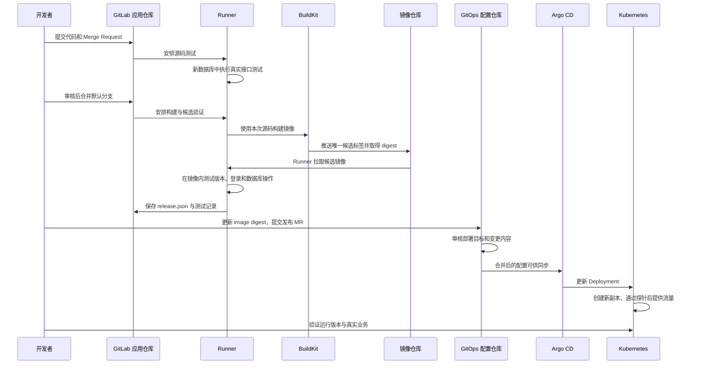
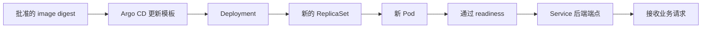

# Kubernetes CI/CD：一次代码提交怎样变成运行中的新版本

## 1．从一次具体修改开始

假设你修改了任务系统的接口，希望把新代码部署到 Kubernetes。一次完整发布需要完成以下事情：保存代码版本，检查程序，构建镜像，测试这个镜像，确定将它部署到哪个环境，更新部署配置，观察新副本启动，验证实际业务请求。

CI 指持续集成，重点是把代码变成经过检查的构建结果。持续交付把合格版本准备好，通过规定的审核后发布；持续部署则进一步自动决定并执行发布。本文采用经过审核的 GitOps 发布流程，Argo CD 在部署配置合并后自动同步。

BBT 项目中的 Kubernetes 提供程序运行位置；GitLab、Runner、镜像仓库、部署配置仓库和 Argo CD 共同完成从代码到运行版本的过程。

## 2．先把每个组件的工作分清楚

| 组件 | 保存或处理什么 | 你主要在哪里观察它 |
|---|---|---|
| 应用 Git 仓库 | Python、网页、Dockerfile、流水线和测试 | commit、Merge Request、分支 |
| GitLab CI | 根据流水线定义安排 Job | Pipeline 页面、Job 日志和产物 |
| GitLab Runner | 领取 Job，准备运行环境并执行命令 | Runner 状态、临时 Pod 和日志 |
| BuildKit | 根据 Dockerfile 构建镜像并上传 | 构建日志和构建元数据 |
| 镜像仓库 | 保存镜像清单和内容层 | image tag、digest、拉取记录 |
| GitOps 仓库 | 保存批准运行的部署配置 | 配置变更、审核和提交记录 |
| Argo CD | 比较 Git 与集群状态并同步 | Application 的 revision、Sync、Health |
| Kubernetes | 创建和更新副本，接收实际流量 | Deployment、Pod、Service、EndpointSlice |
| 监控与业务验证 | 判断新版本是否达到运行要求 | 指标、告警、日志和真实接口结果 |

Runner 创建 CI Pod 时使用 Kubernetes API；构建 Job 执行 Dockerfile 时使用 BuildKit；Argo CD 发布应用时也访问 Kubernetes API。它们使用不同身份，操作范围分别设置。

## 3．完整流程图



代码提交与部署配置提交分别有自己的 commit。镜像 digest 将二者连接起来。每一步应该能找到上一步的输入，以及本步骤产生的结果。

## 4．先说明已有环境实际完成的范围

此前四节点学习环境已经运行过 GitLab CI、rootless BuildKit、TLS 镜像仓库和 Argo CD。保存过成功流水线、镜像构建、Argo CD 同步及真实接口验收记录。

那条流水线的 integration Job 针对已经运行的任务服务执行登录和 PostgreSQL CRUD。它能够检查目标服务的业务连通性；要验证本次新提交的程序，还需要源码测试与候选镜像测试。

本目录提供这样的扩展示例。它在独立数据库中运行被测试程序，并核对镜像内的 `/version`。本次文档工作记录本地候选镜像和配置检查结果；BBT 目标 GitLab 的 CI Lint、Runner 调度及 Argo CD 发布，仍需要在接入环境中执行。

## 5．应用仓库与 GitOps 仓库怎样组织

### 5.1 应用仓库 `tasks-app`

把 `example-app/` 的内容作为独立应用仓库的根目录：

| 文件 | 作用 |
|---|---|
| `app.py` | FastAPI、登录与任务接口、数据库访问、探针和版本接口 |
| `index.html` | 简单学习页面 |
| `requirements.txt` | 应用直接依赖版本 |
| `Dockerfile` | 生成可运行的应用镜像 |
| `.gitlab-ci.yml` | 流水线的阶段和 Job |
| `ci/candidate_test.py` | 启动程序，验证真实接口和数据库 |
| `ci/build.sh` | 认证镜像仓库并使用 BuildKit 构建 |
| `ci/release_metadata.py` | 根据构建与测试结果生成发布记录 |

### 5.2 配置仓库 `tasks-gitops`

把 `gitops/` 的内容作为配置仓库根目录。`chart/` 包含 Helm 的 Chart.yaml、values.yaml 和 templates。

这里保存部署所需的镜像 digest、副本、探针和资源配置。应用运行密码和仓库访问凭据由私有配置提供，部署配置只引用 Secret 名称。

修改 Python 接口时提交应用仓库；决定某环境使用哪个镜像时提交 GitOps 仓库。配置变更需要与代码变更一样可审核、可追踪。

## 6．先准备 GitLab、Registry、Runner 和 Argo CD

### 6.1 基础网络与证书

本文使用示例域名 `gitlab.bbt.example.com`、`registry.bbt.example.com`。部署时修改为自己的真实地址，并确保 Runner 管理进程、CI Pod、BuildKit、Argo CD 和节点各自能够访问所需服务。

| 访问方 | 必须连接的目标 |
|---|---|
| 开发电脑 | GitLab 登录、Git 代码操作 |
| Runner 管理进程 | GitLab API、Job 领取和 Kubernetes API |
| CI helper | GitLab 源码和产物下载、产物上传 |
| BuildKit | 基础镜像、软件依赖源和目标 Registry |
| 候选测试 Pod | 候选镜像仓库及自身测试数据库 |
| Argo CD repo-server | GitOps 仓库、所需 Helm 依赖 |
| Kubernetes 节点 | 运行镜像的仓库 |

TLS 信任也要分别配置。节点能够拉取镜像，并不能证明 BuildKit 容器已经信任相同 CA。Argo CD 读取私有 Git 仓库，也需要自己的证书与凭据配置。

GitLab Omnibus 的 Registry 地址配置示例见 `platform/gitlab.rb.example`。应用配置后检查 GitLab、Registry 的域名、证书 SAN、认证 challenge 和真实镜像推送。

### 6.2 两个 Runner 范围

`bbt-test` Runner 执行源码和候选测试，使用 `ci-test` 命名空间。`bbt-build` Runner 只处理受信任默认分支的构建，使用 `ci-build` 命名空间，并在 GitLab 中设为 Protected。

注册 Runner 时分别选择对应标签，限制项目范围，关闭不需要的无标签 Job 领取。管理 Deployment 使用各命名空间的 `ci-runner` ServiceAccount；临时工作 Pod 使用 `ci-job`。

```bash
kubectl apply -f platform/runner-rbac.yaml
```

`runner-test.toml`、`runner-build.toml` 是注册模板，供 `gitlab-runner register --template-config` 或对应管理方式使用。Runner 认证 Token 放在 Secret 或受保护配置中。文件中的 `[[runners]]` 本身不包含可用认证 Token。

BuildKit rootless 需要用户命名空间等内核能力。示例构建 Runner 使用 Unconfined 的 seccomp/AppArmor 配置，并启用 `--oci-worker-no-process-sandbox`，因此安排在专用受控构建范围。它不挂载宿主机 Docker socket，但仍然需要审查运行权限和可接触的凭据。

`ci-build` 允许对应构建配置使用的运行权限，临时 Job 的 Kubernetes ServiceAccount 不挂载 API Token。Runner 管理身份仅在自己的 CI 命名空间管理工作 Pod，不授予业务命名空间的部署权限。

采用内部 CA 时，编辑 `platform/buildkitd.toml`，使 registry 名称与 `CI_REGISTRY` 一致，提供签发该 Registry 的 CA 文件：

```bash
kubectl -n ci-build create configmap buildkit-config \
  --from-file=buildkitd.toml=platform/buildkitd.toml \
  --from-file=registry-ca.crt=private/registry-ca.crt
```

构建 Runner 把它挂载到 `/etc/buildkit`，BuildKit 的启动参数加载该配置。Runner 管理连接、Git helper 和节点拉取镜像的 CA 仍按各自工具配置。本文构建目标是 linux/amd64，测试与构建 Runner 应选用对应架构的节点。

### 6.3 准备一项测试专用变量

在应用项目的 CI/CD Variables 中创建 `CI_TEST_DB_PASSWORD`，使用随机且 URL 安全的字符串。这项密码只用于临时测试数据库，不能复用业务数据库密码。测试任务结束后数据库容器和其临时数据一起清理。

它需要在计划执行的源码测试流水线中可用。不要为了 Merge Request 测试开放生产密钥。外部 fork 和非受信任贡献者的流水线还应隔离项目 Token、网络、缓存和 Runner。

集成 Registry 的构建认证使用 GitLab 自动提供的 `CI_REGISTRY_USER` 和 `CI_REGISTRY_PASSWORD`，不需要把管理员密码写进源码。

## 7．第一步：提交代码并运行源码测试

开发者创建分支、修改代码并提交 Merge Request。GitLab 读取 `.gitlab-ci.yml`，根据 workflow 和 Job rules 判断本次需要执行哪些任务。

示例允许 Merge Request 流水线和默认分支流水线。MR 先执行 `source_test`；代码合并默认分支后，再执行构建和候选镜像验证。

`source_test` 的过程：

1. Runner 创建一个临时测试 Pod，并取回本次提交的源码。
2. 启动独立的 PostgreSQL service。
3. 在工作目录建立虚拟环境，安装项目依赖。
4. 运行当前源码中的测试程序。
5. 测试程序启动应用，检查版本、未登录访问、错误密码、输入校验和真实数据库 CRUD。
6. 产生 `test-report.json`，失败时 Job 返回非零状态。

候选测试程序会检查应用子进程是否提前退出，等待端口的时间也有明确上限。接口状态或数据结果不符合预期时直接失败。

数据库 services 和 build/helper 容器在 Kubernetes executor 中属于同一 Job 的 Pod，网络和资源安排受 Runner 配置控制。别把这些一次性 CI Pod 当作已经发布的业务副本。

## 8．第二步：BuildKit 构建镜像

默认分支源码测试通过后，`build_image` 执行 `ci/build.sh`。

输入是本次源码、Dockerfile、基础镜像和依赖。输出是镜像仓库中的候选镜像，以及 `build-metadata.json`。

```text
候选标签 = CI_REGISTRY_IMAGE:CI_COMMIT_SHA-CI_PIPELINE_ID
运行引用 = CI_REGISTRY_IMAGE@sha256:镜像内容摘要
```

加入 pipeline ID 可以区分同一提交产生的不同流水线。使用 digest 部署后，集群拉取的是指定的内容。需要配合仓库保留策略，防止仍在运行或需要恢复的 digest 被清理。

构建脚本的关键命令如下：

```bash
buildctl-daemonless.sh build \
  --frontend dockerfile.v0 \
  --local context=. --local dockerfile=. \
  --opt platform=linux/amd64 \
  --opt build-arg:APP_VERSION="$CI_COMMIT_SHA" \
  --output type=image,name="$CI_REGISTRY_IMAGE:$CI_COMMIT_SHA-$CI_PIPELINE_ID",push=true \
  --metadata-file build-metadata.json
```

`context` 是构建允许读取的文件范围；Dockerfile 描述安装依赖和复制文件；`APP_VERSION` 写入镜像环境及标签；`push=true` 上传镜像；metadata 文件记录真实产物摘要。

脚本为 BuildKit 建立临时仓库认证文件，权限设置为 0600，结束时删除。它不作为 CI artifact 上传。基础镜像、依赖和容器软件需要各自的版本管理；本例固定直接依赖，生产复现还应建立完整依赖锁和基础镜像 digest 记录。

## 9．第三步：运行刚构建的候选镜像

`candidate_test` 使用刚生成的唯一候选标签作为 Job image。`GIT_STRATEGY: none` 避免再次把仓库文件覆盖到运行位置，脚本路径是镜像内的 `/app/ci/candidate_test.py`。

这个测试使用新的数据库，启动镜像内的 `/app/app.py`，读取 `/version`，检查它与 `EXPECTED_COMMIT` 一致，再执行真实业务操作。

| 检查 | 要证明的事情 |
|---|---|
| `/version` | 运行程序声明的提交与待发布提交一致 |
| `/livez` | 应用能够响应进程存活请求 |
| `/readyz` | 应用能够完成数据库就绪检查 |
| 未登录和错误密码 | 身份检查保持生效 |
| 空标题等输入 | 输入约束生效 |
| 创建、查询、修改、删除 | 候选镜像的业务逻辑与真实数据库交互完成 |

源码测试检查当前代码，候选测试增加了镜像环境这一环。复制遗漏、依赖缺失、入口错误、用户权限和工作路径问题，都可能在镜像阶段出现。

这个例子没有执行完整的浏览器自动化或多节点负载测试。生产验收应根据应用增加必要的测试，测试结论按实际覆盖范围描述。

## 10．CI 通过后拿到什么

成功的候选测试调用 `release_metadata.py`。它读取构建 digest、测试结果和 CI 提交信息，生成 `release.json`，其中包括：

| 字段 | 用途 |
|---|---|
| `source_commit` | 确认源代码版本 |
| `image_repository` | 确认镜像仓库位置 |
| `image_digest` | 指定镜像内容 |
| `pipeline_url` | 追踪流水线和测试结果 |
| `candidate_verified` | 表示本候选版本通过了配套验证 |

文件内容来自真实构建与测试产物。构建元数据缺失 digest、测试失败或提交不一致，脚本都会终止。

CI artifact 和缓存的作用也需要分清：artifact 保存本次产生并需要交给后续步骤的文件；缓存帮助重复利用依赖。发布依据应指向明确的 artifact、commit 和 digest。

## 11．第四步：通过 GitOps Merge Request 批准发布

此时镜像已经准备好，集群的 Deployment 还没有因为这个候选产物自动改变。发布人员需要在 GitOps 仓库中表达批准运行的版本。

使用编辑器打开 `chart/values.yaml`，把通过测试的 `image_repository` 和 `image_digest` 填入：

```yaml
replicaCount: 2
image:
  repository: 填写本次发布记录中的完整仓库地址
  digest: 填写本次发布记录中的sha256摘要
```

提交一个发布 MR，在描述中附上源码 commit、流水线链接、候选测试结果和目标环境。审核人员检查镜像、命名空间、配置、资源、数据库兼容性和维护要求。

审核通过后合并。示例 GitOps Application 跟踪 main 分支和 chart 路径，Argo CD 会发现这个配置提交。

这种流程中的人工批准属于持续交付的一部分。若采用自动晋级，应为环境设置受控发布身份、过期任务拦截、并发顺序和可审核的发布记录，不能把“CI 成功”直接当作任意环境的发布许可。

## 12．第五步：Argo CD 怎样部署

### 12.1 准备命名空间与私有配置

管理员先创建 `tasks-dev` 命名空间，准备单独的测试环境数据库，再建立应用 Secret 和只读镜像拉取 Secret。

```bash
kubectl create namespace tasks-dev
kubectl -n tasks-dev create secret generic tasks-application \
  --from-env-file=private/tasks-dev.env
kubectl -n tasks-dev create secret generic registry \
  --type=kubernetes.io/dockerconfigjson \
  --from-file=.dockerconfigjson=private/pull-auth.json
```

`tasks-dev.env` 需要 `DATABASE_URL`、`ADMIN_PASSWORD` 和 `ADMIN_SALT`。它们属于目标环境自己的配置，数据库应与 CI 的临时测试数据库分开。

`pull-auth.json` 使用限定 read_registry 的凭据。Argo CD 读取 GitOps 仓库则使用另外的只读 Git 凭据。运行 Pod、构建镜像和读取 Git 分别配置认证。

### 12.2 安装 Argo CD 与连接仓库

```bash
helm upgrade --install argocd charts/argo-cd-10.11.6.tgz \
  -n argocd --create-namespace --wait --timeout 10m
```

命令从完整构建指南根目录执行。管理员通过 Argo CD 的仓库配置添加 GitOps URL、证书信任及只读凭据，确认连接成功。

修改 `platform/argocd.yaml` 中的 URL 和环境名称。首次发布时先在 GitOps 仓库填写合格镜像 digest，再应用 AppProject 和 Application，避免让空版本进入部署流程：

```bash
kubectl apply -f platform/argocd.yaml
kubectl -n argocd get application bbt-tasks-dev
```

### 12.3 Application 的关键字段

| 字段 | 示例含义 |
|---|---|
| `repoURL` | 从哪个配置仓库读取 |
| `targetRevision` | 跟踪哪个分支、标签或提交 |
| `path` | 使用仓库中的哪个目录 |
| `destination.server` | 将资源应用到哪个集群 |
| `destination.namespace` | 将命名空间资源放到哪里 |
| `automated` | 发现差异后按配置自动同步 |
| `prune` | 移除 Git 中不再声明的受管对象 |
| `selfHeal` | 修复集群中偏离 Git 的受管配置 |

AppProject 限定允许的源码仓库、目的命名空间和资源类型。本例允许 Deployment、Service、ServiceAccount、PDB，凭据由管理员预先配置。AppProject 的逻辑约束还需要配合 Argo CD 用户权限和 controller 自身的 Kubernetes RBAC。

Argo CD 通常通过周期检查或仓库 webhook 发现提交。webhook 加快发现速度，同步是否完成仍由 Application 与集群资源状态判断。

## 13．Kubernetes 怎样完成滚动更新

Argo CD 渲染 Helm chart，更新 Deployment 的 Pod 模板中的镜像引用。Deployment 产生新的 ReplicaSet，并逐步创建新 Pod。



示例期望两个副本，`maxUnavailable: 0`，`maxSurge: 1`。更新期间允许增加一个 Pod，并尽量保持两个可用副本。需要为额外副本预留 requests、节点容量、配额和存储条件。

`startupProbe` 为启动过程提供时间，`readinessProbe` 决定是否接收 Service 新流量，`livenessProbe` 判断是否需要重启容器。数据库连接检查放在就绪接口中，进程存活接口保持独立。

`progressDeadlineSeconds` 用于报告发布未取得进展。它本身不会自动把应用恢复成某个旧版本，失败处理需要由发布流程决定。

PDB 主要参与自愿驱逐限制。Deployment 的滚动更新主要受其更新策略控制；两者需要分别理解。

## 14．第六步：怎样确认这次发布成功

### 14.1 对象与副本

```bash
kubectl -n argocd get application bbt-tasks-dev
kubectl -n tasks-dev rollout status deployment/tasks --timeout=180s
kubectl -n tasks-dev get pods -l app=tasks -o wide
kubectl -n tasks-dev get endpointslice -l kubernetes.io/service-name=tasks
kubectl -n tasks-dev get deployment tasks \
  -o jsonpath='{.spec.template.spec.containers[0].image}{"\n"}'
```

确认 GitOps 提交、Deployment digest 和发布记录对应。多个 Pod 的 containerStatuses.imageID 还需要结合运行环境返回的格式理解，可能表示镜像清单或配置内容的引用。

### 14.2 实际业务

```bash
kubectl -n tasks-dev port-forward service/tasks 18083:8080
```

保持转发，在其他终端检查版本和就绪接口：

```bash
curl --fail http://127.0.0.1:18083/version
curl --fail http://127.0.0.1:18083/readyz
```

随后使用专用验证账号执行登录、创建任务、查询、更新、删除自己创建的数据。记录响应、数据和服务版本，避免操作真实用户的业务记录。

一次 port-forward 通常选中一个 Pod。要确认每个副本运行相同版本，可以分别检查各 Pod 的镜像与版本接口；外部访问链路还需要通过实际 Ingress 地址验证。

### 14.3 发布后的观察

观察接口错误率、延迟、容器重启、CPU、内存、数据库连接与告警变化。Argo CD 的 Synced 说明配置同步状态，Healthy 表示其资源健康判断；业务正确性需要上述请求和数据验证共同证明。

## 15．发布失败时怎样处理

| 失败位置 | 主要证据 | 处理对象 |
|---|---|---|
| Runner 不领取 Job | tags、Protected 状态、Runner 在线状态 | Runner 和项目设置 |
| 源码测试失败 | 测试日志、程序退出码、数据库连接 | 当前代码、测试依赖与隔离环境 |
| 构建失败 | Dockerfile 步骤、依赖下载、BuildKit 日志 | 构建环境和依赖 |
| 推送被拒绝 | Registry 认证与项目权限 | 构建凭据、仓库路径、标签策略 |
| 候选镜像拉取失败 | Runner Pod 事件与 Registry 信任 | 节点信任、Job 拉取权限 |
| 候选版本不一致 | `/version` 与提交信息 | 构建输入和镜像选择 |
| GitOps 无变化 | 配置仓库提交与目标分支 | 发布 MR |
| Argo CD 无法生成配置 | repo-server 日志、Helm 渲染错误 | 仓库连接和 chart |
| ImagePullBackOff | Pod 拉取事件 | digest、仓库、CA、pull Secret |
| 新副本无法就绪 | 探针、日志、依赖与资源 | 新版本和环境配置 |
| Pod Ready 但业务失败 | 接口、数据和指标 | 程序逻辑或数据兼容性 |

修改前先确定失败阶段。重复触发整个流水线可能掩盖真正问题，也可能产生更多候选镜像和重复发布请求。

## 16．版本恢复怎样经过 GitOps

发现新版本业务异常后，查找上一次实际验证通过的发布记录。使用文件编辑器把 GitOps 的 image digest 恢复为该记录的值，提交新的 MR，审核后合并。Argo CD 再把这个明确的期望配置同步到集群。

这个过程保留新的修复提交及审核记录。不要在 Argo CD 持续自愈时只修改集群内的镜像字段，否则控制器可能继续把它改回 Git 中声明的版本。

恢复镜像以后仍然检查副本、业务接口和数据。应用旧版本是否能够读取新版本已经修改的数据，需要提前设计和验证。

## 17．数据库变更为什么单独讨论

镜像能够替换，数据库中的删除字段、数据转换和约束变更可能影响多个版本。建议按照兼容性顺序安排：增加兼容字段或结构，发布能够同时处理过渡状态的代码，完成数据迁移，再安排后续清理。

迁移脚本需要版本、锁、超时、备份和失败处理。可以使用专门的 Migration Job，并通过发布流程保证执行顺序。不要让每个副本并发执行未经协调的破坏性迁移。

本示例在启动时建立学习用表结构，不包含生产级迁移系统。实际数据库迁移和恢复能力应有独立测试记录。

## 18．凭据与权限怎样分开

| 身份或凭据 | 合理用途 |
|---|---|
| Runner 认证 Token | 领取该项目允许的 CI Job |
| Runner 管理 ServiceAccount | 在规定 CI 命名空间创建工作 Pod |
| CI Job ServiceAccount | 本例不需要访问 Kubernetes API |
| CI Registry 凭据 | 推送候选镜像 |
| 业务 pull Secret | 读取发布镜像 |
| Argo CD Git 凭据 | 读取批准的部署配置 |
| Argo CD 部署权限 | 维护指定集群与命名空间的受管对象 |
| 业务数据库凭据 | 由运行应用使用，独立于 CI 测试数据库 |

应用 CI 不需要获得整个 Kubernetes 集群的管理员 kubeconfig。手工发布的审核人员也不必把自己的管理员凭据交给流水线。

CI 日志避免开启会输出敏感变量的 shell 跟踪。构建上下文排除 private、认证目录和日志，artifact 只上传需要的测试和发布记录。缓存不保存 Docker 认证文件、kubeconfig 或业务数据库数据。

## 19．并发、HPA 和配置自愈

多个提交可能同时构建。唯一候选标签和 digest 保证版本可识别；发布 MR 审核要避免较旧流水线覆盖已经批准的新版本。

自动晋级场景使用环境级串行发布机制，并检查候选版本是否仍然符合最新发布意图。GitLab resource_group 可以限制 Job 并发，但执行顺序和过期任务仍需要明确规则。

HPA 调整副本时，需要决定 replicas 字段由谁管理。使用 Argo CD 时可以省略其不应管理的副本字段或设置合适的 ignoreDifferences 与 RespectIgnoreDifferences，再实际观察扩缩容与同步行为。

本章 chart 默认使用固定两个副本，便于观察滚动更新。启用 HPA 后，需要同时更新配置和验证方式。

## 20．面试问答

### 01：从提交代码到 Pod 更新，具体经过什么？

提交产生流水线，Runner 取回源码并测试，BuildKit 构建镜像，候选镜像通过验证，发布 MR 批准 digest，Argo CD 更新 Deployment，Kubernetes 创建新副本，通过探针后进入 Service 后端，最后验证业务。

### 02：GitLab、Runner 和 Kubernetes 各自负责什么？

GitLab 保存代码并安排 Job；Runner 准备环境、执行命令和上传产物；Kubernetes 为 CI Pod 与业务 Pod 提供运行和管理能力。它们各自具有身份与权限。

### 03：为什么构建成功以后还需要候选镜像测试？

构建成功说明 Dockerfile 指定的步骤完成。镜像可能缺少运行文件、依赖或权限，入口也可能不正确。候选测试直接运行这份镜像并验证实际业务。

### 04：怎样确认测试到了本次新版本？

使用唯一候选标签，测试镜像内的程序，核对版本接口和本次提交，保留构建 digest 与测试记录。避免只访问已运行的旧服务就认为新版本通过。

### 05：tag 与 digest 分别有什么作用？

tag 用于命名和查找，具体行为受仓库标签策略影响。digest 指定内容摘要，部署通过它确定具体镜像。仓库保留与删除策略仍需要保护需要运行和恢复的内容。

### 06：为什么需要两个 Git 仓库？

应用代码和环境发布配置具有不同审核目标。分开后可以让构建与环境批准各自保留记录；一份应用镜像也可以按照批准流程部署到不同环境。

### 07：Argo CD 为什么会覆盖手工修改？

开启 selfHeal 后，Argo CD 持续比较受管对象与 Git 中期望配置，并按规则修复偏离。长期配置修改应体现在部署仓库中。

### 08：Synced 和 Healthy 分别说明什么？

Synced 表示对比的期望配置与集群状态一致，Healthy 是控制器对资源健康的判断。真实业务功能、数据和完整访问路径仍需另外验证。

### 09：maxUnavailable 为 0 就一定没有请求失败吗？

还要考虑 readiness 真实性、启动时间、节点故障、连接排空、应用退出和依赖可用性。该参数只覆盖滚动更新策略中的可用副本约束。

### 10：为什么要为 maxSurge 预留资源？

新旧副本会短时间共存，额外 Pod 仍然需要 requests、配额和节点容量。不足时新副本可能 Pending，更新无法继续。

### 11：readiness 和 liveness 在发布中分别做什么？

readiness 控制是否接收新流量，liveness 用于判断是否重启容器。数据库短时不可达一般首先影响就绪状态，需要避免大量无效进程重启。

### 12：为什么 Runner 不应该使用集群管理员身份？

流水线执行仓库提交中的代码，权限过大时会扩大错误或恶意提交的影响范围。本例由 Runner 仅管理 CI 命名空间，Argo CD 负责批准后的部署。

### 13：rootless BuildKit 是否可以忽略运行权限？

它减少部分高权限依赖，但内核用户命名空间、seccomp、AppArmor 和进程隔离仍然影响运行与安全。应检查实际配置和能接触的凭据。

### 14：为什么旧服务的接口测试不能覆盖新镜像？

旧服务使用的程序和镜像可能与本次提交不同。测试需要明确目标版本、执行环境和镜像引用，才能解释覆盖了哪个发布候选。

### 15：同一个应用怎样从测试环境进入生产？

让已经通过验证的相同镜像 digest 按审批进入目标环境，分别提供环境自己的配置和 Secret，并在目标环境执行发布验收。避免因为晋级而无意构建出另一份内容。

### 16：恢复旧镜像以后，数据库一定能够继续使用吗？

需要看结构、数据和代码兼容性。镜像恢复与数据恢复是不同工作，数据库迁移应提前考虑版本共存及失败处理。

### 17：缓存和 artifact 怎样区别？

缓存帮助复用依赖，artifact 保存某次 Job 的产出。发布版本需要使用明确的构建、测试及配置记录，不能仅从可变缓存推断来源。

### 18：流水线乱序发布怎样处理？

识别每次流水线的提交和产物，按环境控制发布并发，拒绝已经过期的发布意图。单纯给部署 Job 加锁，还需要定义锁内执行顺序。

### 19：CI/CD 的网络问题从哪里查起？

根据失败阶段列出访问方与目标，检查 DNS、路由、TCP、TLS、认证和服务响应。节点拉取、BuildKit 拉取与 Argo CD 读取 Git 使用不同运行环境，需要分别检查。

### 20：面试时怎样证明自己做过这条流程？

展示一组相互对应的源码 commit、流水线、镜像 digest、发布配置 commit、Argo CD revision、副本状态和业务结果。再用一次实际失败说明怎样定位与恢复，按真实参与范围描述工作。

## 21．一次发布需要保留的记录

| 记录 | 内容 |
|---|---|
| 源代码 | 应用仓库与 commit |
| 构建 | Dockerfile、基础镜像、依赖、流水线和构建元数据 |
| 候选验证 | 实际运行镜像、隔离数据库和测试结果 |
| 发布批准 | GitOps MR、审核人、配置 commit 和目标环境 |
| 运行状态 | Deployment digest、Pod、探针和端点 |
| 业务验收 | 版本、真实接口、数据和发布后观察 |
| 恢复依据 | 上次合格版本、数据兼容性与恢复验证 |

## 22．配置与验证说明

`example-app/` 和 `gitops/` 用于建立两个独立仓库。GitOps 默认 digest 留空，模板会终止渲染；必须使用通过测试的真实构建记录填写。示例域名需要替换，Runner Token、证书和环境 Secret 由管理员私有配置。

本地候选镜像测试使用真实 PostgreSQL 和镜像内的应用。`validation.json` 记录本次验证范围。目标 GitLab 的流水线语法与服务行为通过其 CI Lint 和真实流水线继续核对，Kubernetes 发布按本章的允许、失败和恢复用例验收。

机制核对资料：[GitLab BuildKit](https://docs.gitlab.com/ci/docker/using_buildkit/)、[Kubernetes executor](https://docs.gitlab.com/runner/executors/kubernetes/)、[CI YAML](https://docs.gitlab.com/ci/yaml/)、[发布并发控制](https://docs.gitlab.com/ci/resource_groups/)、[Argo CD 自动同步](https://argo-cd.readthedocs.io/en/stable/user-guide/auto_sync/)、[Argo CD 声明式配置](https://argo-cd.readthedocs.io/en/stable/operator-manual/declarative-setup/)。
