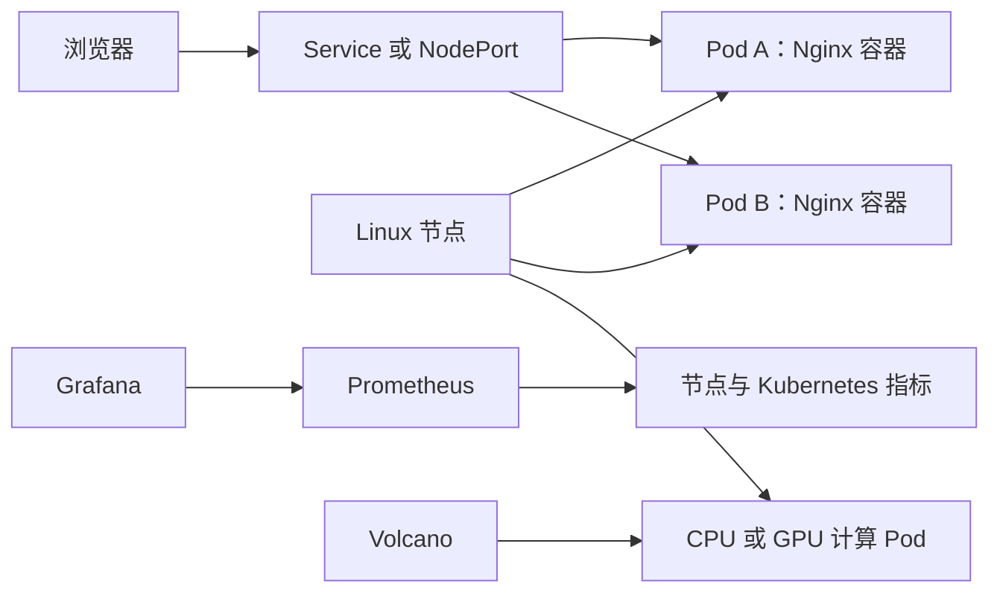

# 一套项目里，五种技术各自做什么

先看一个完整场景：访问者打开 `http://服务器地址:端口`，希望看见网页；团队还希望网页故障时发现问题；计算任务需要 GPU 时，要求相关成员一起获得资源后再运行。



## Linux：机器怎样让程序工作

Linux 是节点的操作系统。它管理 CPU、内存、磁盘、网络和进程。Nginx、containerd、kubelet 都是 Linux 上运行的进程。

| 名称 | 具体含义 | 项目中的例子 |
|---|---|---|
| 文件 | 持久保存在磁盘上的内容 | `index.html`、Dockerfile、Kubernetes YAML。|
| 进程 | 已启动、正在执行的程序 | Nginx、kubelet、containerd。|
| 服务 | 持续提供能力的一组进程 | 网页服务、容器运行服务。|
| 日志 | 程序留下的执行记录 | Nginx 错误日志、kubelet 日志、Pod 日志。|

网页慢时，先确定是 CPU、内存、磁盘或网络出现等待，再查看对应时间的日志。一个指标高并不自动表示故障；要结合请求、错误和用户实际体验判断。

## Docker：怎样保证换机器仍能运行

Docker 把程序的运行文件和依赖准备成镜像。这个项目的 Dockerfile 从 Nginx 基础镜像开始，再复制自己的 HTML 文件。镜像创建出来以后，通过 Docker 启动容器。

```text
HTML 文件 + Nginx 基础镜像 + Dockerfile
                 ↓
            新镜像
                 ↓
       启动多个 Nginx 容器
```

镜像提供初始文件，容器是实际运行中的实例。容器中的进程仍依赖 Linux 内核。上传文件、训练结果、监控历史等需要长期保留的数据，应放在独立存储中；容器内部空间只适合临时运行数据。

## Kubernetes：怎样管理多个容器

Kubernetes 管理多台机器上的容器。它的基本目标是让你表达期望状态，例如“我要一直有两个网页实例”，再持续把实际状态调整到这个要求。

| 对象 | 用一句话理解 | 本项目中的作用 |
|---|---|---|
| Node | 集群中的一台 Linux 机器 | 提供 CPU、内存、网络。|
| Pod | Kubernetes 安排容器运行的基本单位 | 每个 Pod 中运行一个 Nginx。|
| Deployment | 声明镜像、数量和更新策略 | 希望始终保持 2 个 Pod。|
| Service | 稳定访问入口 | 选择当前可用的 Nginx Pod。|
| Namespace | 资源隔离范围 | 这里使用 `cloud-native-lab`。|

Deployment 发现一个 Pod 消失时，会创建替代 Pod。调度器为它选择节点，节点上的 kubelet 与容器运行工具启动容器。Service 会转交请求到通过就绪检查的 Pod。

## Prometheus 与 Grafana：怎样回看发生过什么

Prometheus 定期从指标接口取得数值，再按时间保存。数值加上记录时间组成时间序列。Grafana 从 Prometheus 查询数据，再显示成图表。

node-exporter 提供节点 CPU、内存等指标；kube-state-metrics 提供 Deployment、Pod 等 Kubernetes 对象状态。PrometheusRule 根据已采集的数据定义告警条件；Alertmanager 处理告警分组和通知。

## Volcano：怎样安排一组计算任务

长期网页服务与完成后退出的训练任务不同。训练任务可能需要多个 worker、GPU、队列和最低成员条件。Volcano 在 Kubernetes 上提供批量计算调度能力。

当一个训练需要 4 个 worker 且 4 个都必须运行时，Volcano 可以设置 `minAvailable: 4`。资源只够两个时，任务保持等待；条件满足时，再安排整组成员。这就是成组调度。

## 五种技术的关系

Linux 提供机器资源；Docker 把应用制作成可移动镜像；Kubernetes 让服务容器长期运行；Prometheus 观察运行过程；Volcano 安排需要资源和成员协作的批量计算任务。
