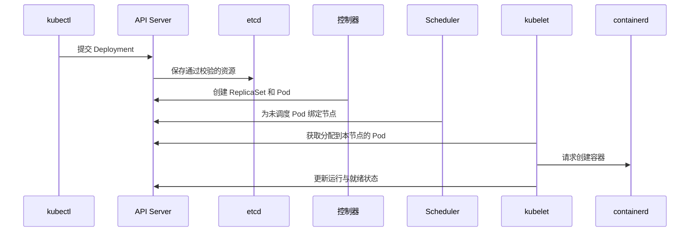
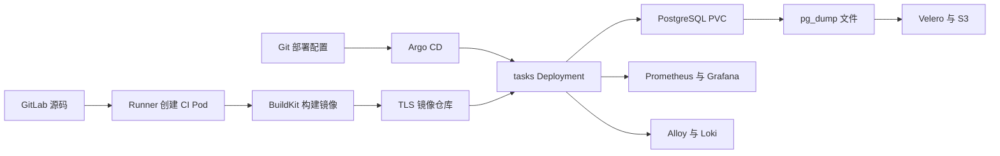

# Kubernetes 入门到项目学习教程

## 1．准备学习环境

本文参考 tianshu 的《K8s 详细入门教程（基于 Docker 背景）》组织学习顺序。参考文章全文已阅读，地址为 https://www.cnblogs.com/fchhk/p/19406111 。本文的环境、对象名称、命令和项目说明依据本次实际部署编写。

学习需要理解 Docker 镜像、容器、端口和目录挂载。准备一个可以执行 kubectl 的终端，并解压《Kubernetes项目完整部署源码.tar.gz》。部署步骤阅读同目录《从零搭建Kubernetes与项目实战.md》，虚拟机与集群安装细节阅读《204节点RKE2集群搭建流程.md》。本文解释操作背后的对象关系，并使用已经运行的项目练习。

| 层次 | 当前环境 | 需要掌握的内容 |
|---|---|---|
| 物理服务器 | 10.100.1.94，204 宿主机 | CPU、内存、磁盘、虚拟化 |
| 虚拟网络 | 192.168.204.0/24 | 网桥、NAT、DHCP、路由 |
| 控制平面 | 192.168.204.11 | API、调度、控制器、etcd |
| 工作节点 | 192.168.204.12～14 | kubelet、containerd、Pod 网络 |
| Kubernetes | RKE2 v1.36.5+rke2r1 | 资源声明、控制循环、应用运维 |
| 项目 | pod-lab、interview-app | 容器实验、任务系统、发布与恢复 |

四台虚拟机每台配置 4 vCPU、4 GiB 内存和 20 GiB 磁盘。全部虚拟机共用同一台物理服务器；物理服务器故障会影响全部节点。当前控制平面只有一个，学习时需要明确这个可用性限制。

下面命令在配置管理员 kubeconfig 的终端执行。Mac 需要保持集群 API 的 SSH 转发；控制平面可以通过 sudo 获取管理员终端后设置：

```bash
export PATH=/var/lib/rancher/rke2/bin:$PATH
export KUBECONFIG=/etc/rancher/rke2/rke2.yaml
kubectl cluster-info
kubectl get nodes -o wide
```

检查四个节点的 Ready 状态、节点地址和版本。`kubectl` 使用 kubeconfig 中的地址、证书和身份访问 API Server；终端工作目录不会决定连接哪个集群。操作之前执行 `kubectl config current-context`，确认连接对象。

## 2．从容器运行理解 Kubernetes

执行一次容器启动命令，只能描述某个时刻的操作。应用运行期间还需要处理进程退出、节点故障、多个副本、访问入口和版本更新。Kubernetes 保存资源的期望状态，控制器持续检查实际状态，并执行创建、更新等操作。

当前节点使用 containerd 运行容器。Docker 在宿主机承担镜像构建等工作。镜像需要匹配节点的 linux/amd64 架构，并且节点必须能够取得镜像及认证信息。

| 概念 | 在当前项目中的例子 | 作用 |
|---|---|---|
| 镜像 | learning/tasks:1.0.1 | 保存程序、运行环境和依赖 |
| 容器 | server、writer、inspector | 运行具体进程 |
| Pod | pod-web 的一个副本 | 提供共享网络及声明的卷挂载 |
| Deployment | pod-web | 管理副本和滚动更新 |
| ReplicaSet | pod-web 对应的副本集合 | 维持符合模板的 Pod 数量 |
| Service | pod-web | 根据标签关联后端并提供稳定访问地址 |
| Namespace | pod-lab | 给资源提供命名范围 |
| ConfigMap | 项目的脚本及网页配置 | 将配置文件提供给容器 |
| Secret | 数据库密码、仓库认证 | 保存需要限制访问的配置 |
| PVC | PostgreSQL 数据卷申请 | 申请持久化存储 |

Namespace 的隔离能力需要 RBAC、配额和网络策略共同配置。Secret 的访问权限需要明确控制，Base64 编码能够还原原文。

## 3．理解创建应用时发生的事情



控制器通过 API Server 观察资源。scheduler 根据 requests、节点条件和调度约束选择节点；kubelet 请求容器运行环境启动进程。网络插件配置 Pod 网络，存储组件准备声明的卷。Pod 的状态可能依次出现 Pending、初始化、Running 等变化。

Running 表示 Pod 已进入运行阶段，接收业务流量还需要检查 Ready。项目中三个普通容器全部就绪时显示 `3/3`。查看状态时同时检查 READY、STATUS、RESTARTS 和事件。

## 4．阅读实际 YAML 文件

解压源码后打开 `pod-lab/workload.yaml` 和 `pod-lab/access.yaml`，按照以下关系阅读。下面的代码块用于解释字段，完整可部署配置保存在源码文件中。

```yaml
apiVersion: apps/v1
kind: Deployment
metadata:
  name: pod-web
  namespace: pod-lab
spec:
  replicas: 2
  selector:
    matchLabels:
      app: pod-web
  template:
    metadata:
      labels:
        app: pod-web
```

`apiVersion` 指定资源 API 组和版本。`kind` 指定对象类型。`metadata.name` 和 `metadata.namespace` 定位对象。`spec.replicas` 声明数量。`selector.matchLabels` 必须匹配 Pod 模板标签。`template` 描述将来创建的 Pod；修改模板通常会触发新的 ReplicaSet 和滚动更新。

Service 的 selector 同样匹配 Pod 标签。`port` 是 Service 提供的端口，`targetPort` 指向容器实际监听端口，`nodePort` 是 NodePort 类型在节点提供的端口。容器的 `containerPort` 字段描述端口，程序仍然需要实际监听对应地址。

使用集群提供的字段说明查阅配置：

```bash
kubectl explain deployment.spec.template.spec
kubectl explain deployment.spec.template.spec.containers.resources
kubectl explain service.spec.ports
kubectl -n pod-lab get deployment pod-web -o yaml
kubectl -n pod-lab get service pod-web -o yaml
```

输出中 `spec` 是声明的配置，`status` 是系统报告的状态。比较两者，可以判断控制器是否已经完成预期操作。

## 5．部署和访问 Pod 项目

首次搭建按照部署手册准备节点目录与监控依赖，然后进入源码 `pod-lab/` 执行 `bash deploy.sh`。已有环境直接开始下面检查：

```bash
kubectl -n pod-lab get deployment,replicaset,pod,service -o wide
kubectl -n pod-lab rollout status deployment/pod-web --timeout=180s
kubectl -n pod-lab get endpointslice -l kubernetes.io/service-name=pod-web
kubectl -n pod-lab port-forward service/pod-web 18084:8080
```

保持最后一个命令运行，在 Mac 浏览器访问 `http://127.0.0.1:18084`。网页显示计数器和 Pod 状态。另一个终端可以执行：

```bash
curl --fail http://127.0.0.1:18084/status.json
```

本机请求经过 kubectl 与 API Server 到达选中的 Pod。port-forward 选中的 Pod 被删除后，需要重新建立转发。使用这个入口验证页面可达，集群内部的 Service 转发另外通过客户端 Pod 验证：

```bash
kubectl -n pod-lab exec client-allowed -- nslookup pod-web.pod-lab.svc.cluster.local
kubectl -n pod-lab exec client-allowed -- wget -qO- -T 5 http://pod-web:8080/status.json
```

DNS 返回 Service 地址，Service 的后端由匹配标签及就绪条件的 EndpointSlice 描述。测试多副本时观察实际响应中的 Pod 信息和端点列表；单个长期连接可能持续使用同一个后端。

## 6．观察容器、进程和日志

```bash
POD=$(kubectl -n pod-lab get pod -l app=pod-web -o jsonpath='{.items[0].metadata.name}')
kubectl -n pod-lab describe pod "$POD"
kubectl -n pod-lab logs "$POD" -c writer --tail=20
kubectl -n pod-lab exec "$POD" -c inspector -- ps
kubectl -n pod-lab exec "$POD" -c inspector -- wget -qO- http://127.0.0.1:8080/status.json
```

server 提供 HTTP 服务，writer 更新共享文件，inspector 提供检查工具。容器共享 Pod 的网络命名空间，所以 localhost 可以访问 server。每个容器仍然有各自的文件系统；通过共同挂载 emptyDir 才能共享 `/data` 文件。

本项目设置 `shareProcessNamespace: true`，inspector 可以查看其他容器的进程。阅读进程列表后，在《Pod项目实操学习手册》中执行终止 writer 的实验，比较 Pod UID、containerID 和 restartCount。容器重启时 Pod UID 保持一致；Pod 重建时 UID 改变。

## 7．理解探针、自愈和数据生命周期

| 机制 | 本项目的操作 | 应观察的结果 |
|---|---|---|
| readinessProbe | 删除 `/data/ready` 后恢复文件 | Pod 暂停接收 Service 新请求，再恢复就绪 |
| livenessProbe | 删除 `/data/live` | server 容器重新启动 |
| Deployment 副本维护 | 删除一个 pod-web Pod | ReplicaSet 创建替代 Pod |
| emptyDir | 在 Pod 中创建标记后重建 Pod | 新 Pod 使用新目录 |
| PVC | notebook 写入笔记后重建 Pod | 笔记内容保留 |

startupProbe 在启动期间保护慢启动程序；readinessProbe 决定就绪状态；livenessProbe 失败达到阈值后触发容器重启。任务系统的 readiness 检查数据库连接，liveness 检查应用进程响应。数据库短时中断期间，应用暂时退出就绪状态，避免无效的重复重启。

练习删除前记录名称和 UID：

```bash
kubectl -n pod-lab get pods -l app=pod-web -o custom-columns=NAME:.metadata.name,UID:.metadata.uid,NODE:.spec.nodeName
kubectl -n pod-lab delete pod "$POD"
kubectl -n pod-lab rollout status deployment/pod-web --timeout=180s
kubectl -n pod-lab get pods -l app=pod-web -o wide
```

随后重新取得 `POD` 变量。自动重建能恢复声明的副本，应用的数据完整性需要存储、事务和备份配合。Local PV 绑定具体节点，NFS 数据可由多个节点访问；NFS 服务也运行在同一物理宿主机，仍然存在共同故障范围。

## 8．从 Pod 实验进入任务系统

任务系统包含 HTML/JavaScript 页面、FastAPI 后端和 PostgreSQL。用户登录后执行任务创建、读取、修改和删除，数据写入数据库 PVC。页面入口为 `http://127.0.0.1:18083`，可以通过下面命令建立转发：

```bash
kubectl -n interview-app get deployment,pod,service,pvc,hpa,pdb
kubectl -n interview-app port-forward service/tasks 18083:8080
```

使用私有凭据文件中的学习账号登录。创建一条自己能够辨认的任务，修改完成状态，刷新页面确认保存。打开后端日志，核对请求方法、路径、状态码及处理时间。删除一个应用 Pod 并等待副本恢复，再确认任务仍然存在。

正式验收使用源码 `interview/verify-application.py` 执行真实接口操作，包含认证与数据检查。执行脚本之前依照部署手册创建 Python 环境、设置 KUBECONFIG 并保持页面转发。

资源 requests 参与调度和 CPU HPA 利用率计算；limits 限制资源使用。CPU 达到限制可能出现节流，内存超过限制可能触发 OOM。当前 HPA 将副本数量控制在 2～4，CPU 目标值为 requests 的 50%。HPA 调整副本后，Argo CD 配置需要允许这个字段由 HPA 管理。

## 9．串联发布、监控、日志和备份



GitLab 的 integration Job 对已经运行的服务执行真实接口测试，build Job 构建并推送镜像。Argo CD 读取 Git 中的部署清单，使集群配置与提交保持一致。学习时分别查看流水线提交、镜像标签、Deployment 镜像和 Argo CD revision，理解这些对象如何关联。

Prometheus 按 ServiceMonitor 配置采集指标，Grafana 查询并展示指标。Pod 项目的指标路径为 `/metrics.txt`，任务系统使用 `/metrics`。在 Prometheus 查询 `pod_lab_heartbeats_total`，观察两个 Pod 对应的时间序列。Alloy 采集容器日志并写入 Loki，在 Grafana 按 namespace、pod 和 container 查询。

备份采用 PostgreSQL 逻辑导出、文件备份和 Kubernetes 对象备份。恢复验证创建新的命名空间、不同的 PV 和新的数据库数据目录，再导入文件并查询原有记录。备份任务完成、恢复任务完成、业务数据可查询，需要分别检查。

## 10．根据证据定位故障

先确认命名空间和对象，再查看状态、事件与日志：

```bash
kubectl -n interview-app get pods -o wide
kubectl -n interview-app get events --sort-by=.lastTimestamp
kubectl -n interview-app describe deployment tasks
kubectl -n interview-app get endpointslice
kubectl -n interview-app logs deployment/tasks --tail=50
```

| 现象 | 检查顺序 | 原因定位依据 |
|---|---|---|
| Pending | Pod 事件、requests、节点条件、PVC | FailedScheduling 或卷绑定信息 |
| ImagePullBackOff | 镜像地址、仓库连接、CA、认证 | 拉取失败事件中的具体错误 |
| CrashLoopBackOff | previous 日志、退出原因、配置 | 进程退出码与最后一次状态 |
| OOMKilled | 内存 limits、使用量、terminated.reason | 内存限制与 OOM 状态 |
| Running 但网页失败 | Ready、Service selector、EndpointSlice、网络策略 | 后端端点及实际连接结果 |
| 数据库恢复后数据缺少 | PVC、PV、挂载目录、数据库连接目标 | 数据位置与实际查询结果 |

故障演练按顺序执行，完成一项并验证恢复后再执行下一项：Pod 三类故障、探针失败、错误镜像发布、数据库中断、HPA 负载、备份恢复。源码提供对应脚本，详细命令见《Pod项目实操学习手册》和《Kubernetes平台部署与学习流程》。PDB 演练只驱逐 `app=pod-web` 的项目 Pod，结束后恢复节点调度。

## 11．完成学习记录与面试练习

每个实验记录执行位置、对象名称、修改字段、状态变化、日志证据和恢复验证。用自己的语言回答下面问题，再执行对应命令证明回答。

1. 删除容器进程与删除 Pod，分别由哪个组件处理？比较 UID 和 restartCount。
2. Deployment 为什么需要标签选择器？展示 Pod 模板与 ReplicaSet 的关系。
3. Service 地址稳定时后端为什么可以变化？展示 EndpointSlice。
4. readiness 失败后为何能够避免请求进入异常副本？展示端点就绪条件。
5. emptyDir、Local PV 和 NFS 分别在什么情况下保留数据？展示实际挂载位置。
6. HPA 使用 CPU requests 的方式是什么？结合 requests 计算目标使用量。
7. PDB 能够约束哪些中断？解释直接删除 Pod 和节点断电的行为。
8. Argo CD 如何处理手工修改？查看同步状态和 Git 提交。
9. 数据库不可达时为何仍然保持应用进程运行？检查探针配置与重启次数。
10. 怎样证明备份能够恢复业务？展示新 PV、文件摘要和恢复后的查询。

本次验收材料保存在源码包 `evidence/`。最终记录包含四个 Ready 节点、65 个活动 Pod 全部就绪、36 个 Prometheus 采集目标 UP、CI 成功、Argo CD Synced/Healthy，以及实际故障和恢复结果。数量属于验收时刻的快照；后续学习操作会改变实时数量，应以当前状态及对应证据判断。
