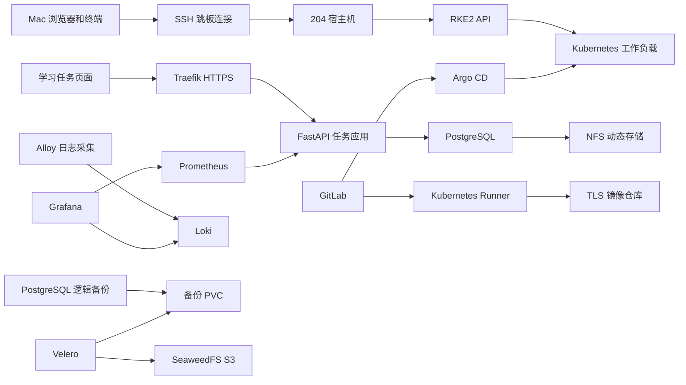

# 204 Kubernetes 平台部署与学习流程

## 网络、机器与操作边界

| 地址 | 身份 | 用途 |
|---|---|---|
| 10.100.1.91 | SSH 跳板机 | 通过现有接入网络进入实验环境 |
| 10.100.1.94 | 204 物理宿主机 | 运行 KVM 虚拟机、NFS、GitLab、镜像仓库和对象存储 |
| 192.168.204.1 | 宿主机实验网桥 | 虚拟机访问宿主机服务 |
| 192.168.204.11 | rke2-server-1 | 控制平面、etcd |
| 192.168.204.12～14 | rke2-worker-1～3 | 应用、监控、日志与发布管理组件 |

四台虚拟机均为 4 vCPU、4 GiB 内存、20 GiB 系统磁盘。新增服务放在独立命名空间和 `/var/lib/interview-lab` 目录。原有宿主机业务容器保持独立运行。



所有虚拟机和宿主机服务仍然依赖同一台物理机器。此环境用于学习部署和恢复流程，无法抵抗整台物理宿主机损坏。生产环境需要独立物理故障域，以及存放在其他机器或其他站点的备份。

## 接入和访问方法

在自己的终端配置授权网络和 SSH 接入。接入地址和认证信息由环境管理员提供。下面演示已经登录实验跳板机后进入宿主机、控制平面的方法，地址需要根据自己的网络修改：

```bash
ssh root@10.100.1.94
ssh -i /var/lib/rke2-lab/id_ed25519 ubuntu@192.168.204.11
sudo -i
export PATH=/var/lib/rancher/rke2/bin:$PATH
export KUBECONFIG=/etc/rancher/rke2/rke2.yaml
kubectl get nodes
```

SSH 的 `-L` 把本地监听端口转发到远端目标，`-D` 提供 SOCKS 服务。`kubectl port-forward` 通过 Kubernetes API 转发到选中的 Pod。浏览器连接本机回环地址后，请求通过这些连接进入实验网络。

系统 Wi-Fi 代理与这些 SSH 端口转发分别配置。运行学习项目不需要修改系统 DNS、Wi-Fi 代理、默认路由或者路由器限速设置。

## 部署文件和安装顺序

源码包中的目录对应以下职责：

| 目录或文件 | 作用 |
|---|---|
| host/ | NFS、独立 GitLab、TLS 仓库、对象存储及节点仓库信任配置 |
| charts/ | Helm values，明确服务副本数、存储和资源限制 |
| k8s/ | 应用、证书、Runner、备份、恢复和演练清单 |
| app/ | 任务系统源码、Dockerfile、依赖、真实集成测试和 CI 配置 |
| app/gitops/ | Argo CD 管理的应用 Deployment |
| verify-application.py | 真实 HTTP、权限、数据库和 TLS 验收 |
| application-drills.py | 数据库故障与应用 Pod 重建演练 |
| verify-backup.py | 新命名空间、新卷和新数据库的备份恢复验证 |
| release-drill.sh | 错误镜像发布和配置修复演练 |

部署顺序：现有 RKE2 和监控 → NFS 导出与 CSI → cert-manager → 私有 CA 和 TLS 仓库 → PostgreSQL 与应用 → HTTPS Ingress → Loki 与 Alloy → GitLab 与 Runner → Argo CD → Velero 和恢复演练。

## NFS 动态存储

宿主机安装 NFS 服务，将 `/var/lib/interview-lab/nfs` 导出给 `192.168.204.0/24`。`host/setup-nfs.sh` 创建导出目录并启用服务。

```bash
sudo exportfs -v
kubectl -n kube-system get pods -l app.kubernetes.io/instance=nfs
kubectl get storageclass interview-nfs
kubectl get pvc -A
```

`csi-driver-nfs` 根据 PVC 创建独立子目录，StorageClass 使用 Retain 回收策略。PVC 的请求容量不等同于宿主机文件系统对每个目录实施容量配额，实际配额需要额外配置。

面试知识：PV 描述可用存储，PVC 表达工作负载的存储申请，StorageClass 定义动态供应参数。ReadWriteOnce 主要约束节点挂载方式，不能直接当作“只允许一个 Pod 使用”。NFS 的多节点访问能力也不能替代数据库自身的主从复制。

## 私有镜像仓库和证书

仓库地址：`192.168.204.1:15000`。仓库启用 TLS 和 bcrypt htpasswd 认证。CA 私钥保存在宿主机专用目录；CA 公钥安装到本实验的 containerd 和 Docker 仓库信任目录。

节点文件：

```text
/etc/rancher/rke2/registries.yaml
/etc/rancher/rke2/interview-ca.crt
```

配置 CA 后重启对应的 rke2-server 或 rke2-agent，并等待节点恢复 Ready。应用命名空间的 imagePullSecret 提供仓库账号。

面试知识：CA 信任解决服务器身份校验，仓库账号解决访问认证，imagePullPolicy 决定何时检查或下载镜像。ImagePullBackOff 应检查事件、镜像名称、网络、认证和 CA。证书问题通过正确的信任配置解决。

## 真实应用和数据库

任务系统使用 FastAPI、psycopg、PostgreSQL 和浏览器 JavaScript，提供登录、任务创建、查询、修改和删除。密码使用随机 salt 和 PBKDF2-HMAC-SHA256 验证；SQL 使用参数绑定。登录会话保存在数据库，Cookie 配置 HttpOnly 和 SameSite。

学习账号为 `learner`，随机密码保存在单独的私有访问凭据文件中。系统仅用于本实验网络；公网服务还需要完善账号生命周期、请求限制和审计策略。

```bash
kubectl -n interview-app get pods,service,pvc,hpa,pdb
kubectl -n interview-app logs deployment/tasks --tail=30
kubectl -n interview-app logs deployment/postgres --tail=30
kubectl -n interview-app port-forward service/tasks 18083:8080
```

打开本机 `http://127.0.0.1:18083` 登录并操作任务。刷新页面后观察请求结果中的 Pod 名称；port-forward 固定到某个 Pod，不能用这个入口证明 Service 已经平均分配请求。

应用 `/livez` 检查进程是否存活，`/readyz` 检查数据库连接，`/metrics` 提供真实 HTTP 请求计数。数据库使用单副本和持久化 PVC，应用使用两个副本。

数据库故障演练：缩容 postgres 到零，确认应用退出就绪状态且现有应用容器保持存活；恢复 postgres 后确认就绪恢复和原有任务数据存在。执行源码包的 `application-drills.py` 自动验证这些条件。

## HTTPS Ingress 和证书续期

cert-manager 的 ClusterIssuer 使用本实验 CA 签发 `tasks-tls`。Traefik 根据 Host `tasks.204.test` 将 HTTPS 请求交给 tasks Service。

```bash
kubectl get clusterissuer interview-ca
kubectl -n interview-app get certificate tasks-tls
kubectl -n interview-app describe certificate tasks-tls
kubectl -n interview-app get ingress tasks
```

本机 HTTPS 转发端口为 18443，命令行可以显式指定解析和 CA：

```bash
curl --cacert ca.crt \
  --resolve tasks.204.test:18443:127.0.0.1 \
  https://tasks.204.test:18443/readyz
```

证书有效期为 90 天，提前 15 天续期。Certificate 状态包含到期和下一次续期时间，验收同时检查实际 TLS 主机名和 CA 链。浏览器若使用该私有 CA，需要自行建立对该 CA 的信任。

## 指标和日志

Prometheus、Grafana、Alertmanager、node-exporter 和 kube-state-metrics 继续使用现有部署。任务系统和 Pod 项目通过 ServiceMonitor 加入采集。

Prometheus 学习查询：

```promql
up
learning_http_requests_total
sum by (status) (rate(learning_http_requests_total[5m]))
pod_lab_heartbeats_total
sum by (pod) (rate(container_cpu_usage_seconds_total{namespace="interview-app",container="tasks"}[5m]))
kube_deployment_status_replicas_available{namespace="interview-app"}
```

Alloy 从 Kubernetes 容器日志 API 采集日志并写入 Loki，Grafana 的 Loki 数据源地址为 `http://loki-gateway.logging.svc.cluster.local`。Alloy 会读取集群容器日志，其 ServiceAccount 的权限范围应纳入生产环境权限评估。

Grafana Explore 中选择 Loki，查询：

```logql
{namespace="interview-app",container="tasks"}
{namespace="pod-lab",container="writer"}
```

先执行一次真实登录或创建任务，再确认日志中存在对应请求。Loki 单副本保存七天日志，数据位于 worker-2 上的 Local PV，WAL 使用本地文件系统。Loki 的调度受 PV 节点亲和性约束。

## HPA、PDB 和错误发布

应用 HPA 根据 CPU 使用率扩缩容，目标为 requests 的 50%，最少两个、最多四个副本。计算目标依赖容器 CPU requests 和 Metrics Server。

```bash
kubectl -n interview-app top pods
kubectl -n interview-app get hpa tasks -w
kubectl -n interview-app describe hpa tasks
```

负载 Job 持续三分钟，通过集群 Service 发出真实登录请求。PBKDF2 密码验证产生实际 CPU 消耗，观察 HPA 的 desiredReplicas、当前副本数、CPU 指标和 SuccessfulRescale 事件。负载结束后等待缩容稳定窗口。

PDB 设置 minAvailable=1，用于限制自愿驱逐。更新策略设置 maxUnavailable=0、maxSurge=1。`release-drill.sh` 暂停 Argo CD 自动同步，发布一个不存在的镜像，验证旧副本仍然可用，再恢复演练前的实际镜像版本并重新启用自动同步。

面试知识：HPA 调整副本数量，调度器为新 Pod 选择节点；requests 参与调度和 CPU 利用率计算，limits 约束实际资源使用。错误镜像发布时应检查 Deployment 条件、ReplicaSet、Pod 事件和可用副本数。

## GitLab CI、Runner 和 Argo CD

GitLab CE 在宿主机专用容器运行，实验网桥监听端口 18080。Runner 使用 Kubernetes executor，每个 CI Job 创建临时 Pod。Runner 的 API 权限限制在 `ci` 命名空间，CI 工作 Pod 使用独立 ServiceAccount。

流水线包含两个阶段：

1. integration：通过真实 HTTP 登录并对 PostgreSQL 数据完成创建、读取、修改、删除和未登录拒绝检查。
2. build：使用 rootless BuildKit 构建镜像，验证仓库 CA，并推送 `learning/tasks:1.0.1`。

构建依赖和 Python 基础镜像保存在内部仓库或项目依赖目录中。CI 不挂载宿主机 Docker socket。rootless BuildKit 的运行环境需要允许其使用所需的用户命名空间和进程操作，相关配置位于 Runner 模板。

Argo CD 读取仓库 `root/learning-tasks` 的 main 分支，管理 `gitops/` 中的 tasks Deployment，并启用自动同步和配置漂移修复。HPA 管理 replicas，Argo CD 对该字段配置忽略规则，避免两个控制器反复修改副本数。

```bash
kubectl -n ci get pods
kubectl -n ci logs deployment/gitlab-runner --tail=50
kubectl -n argocd get application learning-tasks
kubectl -n argocd describe application learning-tasks
```

学习时修改代码、执行真实测试、构建新镜像标签，再手动编辑 GitOps 文件中的镜像版本并提交。通过 GitLab 查看流水线日志，通过 Argo CD 查看提交版本、同步状态和实际资源差异。配置修复使用明确的文件编辑和新提交。

## PostgreSQL 逻辑备份与 Velero 恢复

`backup-lab` 命名空间的 CronJob 每六小时执行一次 pg_dump，将逻辑备份写入 `database-dumps` PVC。Velero 在备份生成半小时后，把该命名空间的资源和文件内容备份到 SeaweedFS S3，保留七天。

直接复制运行中的数据库数据目录，无法替代数据库一致性备份。本环境使用 pg_dump 生成可以交给 pg_restore 的逻辑备份文件。

```bash
kubectl -n backup-lab get cronjob,job,pvc,pod
kubectl -n velero get backupstoragelocation
kubectl -n velero get backup,restore,podvolumebackup,podvolumerestore
kubectl -n velero logs deployment/velero --tail=60
```

`verify-backup.py` 的验收过程：生成实际 dump → 执行 Velero 文件备份 → 恢复到 `backup-restored` → 比较 SHA256 → 确认源 PVC 与恢复 PVC 使用不同 PV → 创建新的 PostgreSQL 数据卷 → pg_restore → 查询原来的业务验收记录。

备份与恢复都必须达到 Completed，文件摘要一致且新数据库能够查询到记录，才能确认这一恢复链路有效。

## 面试讲解练习

| 问题 | 回答时应结合的实际证据 |
|---|---|
| 容器退出与 Pod 重建有什么区别？ | restartCount、containerID、Pod UID、ReplicaSet ownerReferences |
| readiness 失败后流量如何变化？ | Ready 条件、EndpointSlice、Service 实际请求 |
| 为什么数据库故障没有触发应用反复重启？ | /livez 与 /readyz 的依赖边界、容器重启次数 |
| ImagePullBackOff 如何定位？ | 镜像名称、拉取事件、仓库认证、证书链和网络连接 |
| HPA 为什么没有扩容？ | Metrics Server、CPU requests、目标指标、扩容事件、最大副本数 |
| PDB 能否防止所有停机？ | 驱逐 API、自愿中断、节点故障和直接删除行为 |
| ConfigMap 与 Secret 如何更新？ | 文件挂载和环境变量的更新方式、应用重新加载机制 |
| NFS PVC 是否实现数据库高可用？ | 存储共享与数据库复制的职责、单副本限制 |
| CI 和 GitOps 分别负责什么？ | 测试构建推送日志、Git 声明配置、Argo 同步状态 |
| 如何证明备份可以恢复？ | 新命名空间、新 PV、备份摘要、实际恢复后的业务查询 |
| 如何避免泄露密码？ | 私有凭据文件、Kubernetes Secret、CI masked variable、源码包排除认证文件 |

学习时先复述请求经过的完整路径，再展示相关 Kubernetes 对象和实际日志，最后解释故障触发条件与恢复结果。
