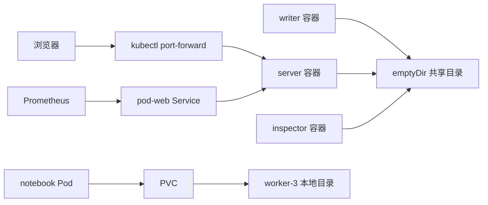

# 204 集群 Pod 项目实操学习手册

## 环境和操作位置

四台 Ubuntu 虚拟机运行 RKE2：`rke2-server-1` 为控制平面，`rke2-worker-1/2/3` 为工作节点。每台虚拟机配置为 4 vCPU、4 GiB 内存、20 GiB 系统磁盘。全部虚拟机位于同一台物理宿主机，物理宿主机故障会影响整个实验环境。

项目使用 `pod-lab` 命名空间。示例命令需要在已经配置集群管理员 kubeconfig 的终端执行。在控制平面上可以运行：

```bash
export PATH=/var/lib/rancher/rke2/bin:$PATH
export KUBECONFIG=/etc/rancher/rke2/rke2.yaml
kubectl get nodes
kubectl -n pod-lab get pods -o wide
```

Mac 当前工作目录的配置位于 `work/monitoring/kubeconfig`，需要保持 SSH API 转发连接。本项目源码包提供全部 YAML、网页、脚本和验收脚本。

本机页面入口为 `http://127.0.0.1:18084`。重新打开入口的命令：

```bash
kubectl -n pod-lab port-forward service/pod-web 18084:8080
```

此终端需要保持运行。port-forward 依赖选中的 Pod；删除该 Pod 后需要重新运行命令。

## 项目的组成

| 对象 | 名称 | 用途 |
|---|---|---|
| Deployment | pod-web | 维持两个 Pod，练习重建、扩容和滚动更新 |
| initContainer | initialize | 初始化网页、计数器和探针文件 |
| 普通容器 | server | BusyBox httpd，监听 8080，提供网页与指标 |
| 普通容器 | writer | 每两秒更新计数器、状态 JSON 和 Prometheus 指标 |
| 普通容器 | inspector | 提供交互终端，查看共享进程和文件 |
| Service | pod-web | ClusterIP 服务发现，并提供 NodePort 30082 |
| StatefulSet | notebook | 练习稳定名称和持久化存储 |
| PVC | data-notebook-0 | 保存笔记文件 |
| NetworkPolicy | pod-web-ingress | 允许指定客户端和监控访问 |
| ServiceAccount | learner | 仅具有项目资源的读取权限 |
| PDB | pod-web | 自愿驱逐时至少保留一个可用 Pod |
| ServiceMonitor | pod-web | Prometheus 采集项目心跳指标 |



## 实验一：识别 Pod 和容器

```bash
kubectl -n pod-lab get deployment,pod,service
POD=$(kubectl -n pod-lab get pod -l app=pod-web -o jsonpath='{.items[0].metadata.name}')
kubectl -n pod-lab describe pod "$POD"
kubectl -n pod-lab get pod "$POD" -o jsonpath='{.metadata.uid}{"\n"}{.status.containerStatuses}{"\n"}'
```

观察 `3/3 Running`，表示三个普通容器均就绪。initContainer 单独显示在初始化状态中。Pod 有自己的 UID，三个容器分别有自己的 containerID 和 restartCount。

面试知识：Pod 是 Kubernetes 调度的基本单位。Deployment 通过 ReplicaSet 维持 Pod 数量。容器进程退出时 kubelet 根据重启策略处理；删除 Pod 后由上层控制器创建新的 Pod。

## 实验二：查看真实进程和 localhost 通信

```bash
kubectl -n pod-lab exec "$POD" -c inspector -- ps
kubectl -n pod-lab exec "$POD" -c inspector -- cat /data/writer.pid
kubectl -n pod-lab exec "$POD" -c inspector -- wget -qO- http://127.0.0.1:8080/status.json
kubectl -n pod-lab logs "$POD" -c writer --tail=10
```

本项目明确设置 `shareProcessNamespace: true`，因此 inspector 可以查看 writer 和 httpd 的进程。普通 Pod 默认不会在容器之间共享 PID 命名空间。相同 Pod 的容器共享网络命名空间，可以通过 localhost 通信。

面试知识：相同 Pod 的容器共享 IP 和端口空间，同时监听同一个地址、端口会产生冲突。进程共享需要显式配置。启用进程共享时，业务进程通常不会成为 PID 1；不要随意终止 PID 1。

## 实验三：终止 writer，观察容器重启

```bash
kubectl -n pod-lab get pod "$POD" -o jsonpath='{.metadata.uid}{"\n"}{.status.containerStatuses}{"\n"}'
kubectl -n pod-lab exec "$POD" -c inspector -- sh -ec 'kill -TERM "$(cat /data/writer.pid)"'
kubectl -n pod-lab get pod "$POD" -w
kubectl -n pod-lab logs "$POD" -c writer --previous --tail=10
```

writer 的 restartCount 增加，Pod UID 保持一致，server 容器继续运行。`--previous` 查看该容器上一次实例的日志。共享目录中的计数器在容器重启后保留。

## 实验四：readiness 和 liveness

```bash
kubectl -n pod-lab exec "$POD" -c inspector -- rm /data/ready
kubectl -n pod-lab get pods
kubectl -n pod-lab get endpointslice -l kubernetes.io/service-name=pod-web -o yaml
kubectl -n pod-lab exec client-allowed -- wget -qO- -T 5 http://pod-web:8080/status.json
kubectl -n pod-lab exec "$POD" -c inspector -- touch /data/ready
kubectl -n pod-lab wait --for=condition=Ready pod/"$POD" --timeout=60s
kubectl -n pod-lab exec "$POD" -c inspector -- rm /data/live
kubectl -n pod-lab get pod "$POD" -w
```

readiness 文件删除后，该 Pod 暂时停止接收 Service 新流量，server 的 restartCount 保持一致。恢复文件后重新进入就绪状态。liveness 文件删除后，server 容器被重启；启动脚本会重新创建该文件。

面试知识：startupProbe 保护慢启动；readinessProbe 控制是否接收流量；livenessProbe 控制是否重启容器。数据库短时不可达通常应影响应用 readiness。将数据库故障直接作为应用 liveness 失败条件，容易产生无效重启。

## 实验五：emptyDir 生命周期

```bash
kubectl -n pod-lab exec "$POD" -c inspector -- touch /data/ephemeral-marker
kubectl -n pod-lab delete pod "$POD"
kubectl -n pod-lab rollout status deployment/pod-web --timeout=180s
kubectl -n pod-lab get pods -l app=pod-web -o wide
```

重新取得新 Pod 名称，在 inspector 中检查 `/data/ephemeral-marker`。新 Pod 的 emptyDir 不包含原来的标记文件。initContainer 会为新 Pod 初始化新计数器。

面试知识：emptyDir 与 Pod 生命周期相关，容器重启不会清除它，Pod 删除后数据会丢失。`emptyDir.medium: Memory` 使用内存，其写入可能计入容器内存使用量。

## 实验六：PVC 和 StatefulSet

```bash
kubectl -n pod-lab exec notebook-0 -- sh -ec 'printf "完成 PVC 实验\n" > /data/notes.txt'
kubectl -n pod-lab get pvc
kubectl -n pod-lab delete pod notebook-0
kubectl -n pod-lab wait --for=condition=Ready pod/notebook-0 --timeout=180s
kubectl -n pod-lab exec notebook-0 -- cat /data/notes.txt
kubectl get pv pod-lab-notebook -o yaml
```

Pod 名称仍为 notebook-0，UID 发生变化，笔记内容保留。该实验使用 worker-3 上的 Local PV，具有节点亲和性；节点不可用时不能自动迁移原有磁盘数据。回收策略为 Retain，删除 PVC 后需要管理员处理保留的数据和 PV 状态。

## 实验七：DNS、Service、网络策略

```bash
kubectl -n pod-lab exec client-allowed -- nslookup pod-web.pod-lab.svc.cluster.local
kubectl -n pod-lab exec client-allowed -- wget -qO- -T 5 http://pod-web:8080/status.json
kubectl -n pod-lab exec client-denied -- wget -qO- -T 3 http://pod-web:8080/status.json
kubectl -n pod-lab get networkpolicy -o yaml
```

允许来源能够读取 JSON，未允许来源发生连接超时。NetworkPolicy 需要网络插件实际执行规则；本集群使用 Canal。排查网络问题时依次检查 Pod 就绪、标签选择器、EndpointSlice、DNS、网络策略和节点网络。

## 实验八：RBAC

```bash
kubectl auth can-i list pods -n pod-lab --as=system:serviceaccount:pod-lab:learner
kubectl auth can-i delete pods -n pod-lab --as=system:serviceaccount:pod-lab:learner
kubectl auth can-i get secrets -n pod-lab --as=system:serviceaccount:pod-lab:learner
```

依次得到 yes、no、no。`--as` 需要当前操作账号拥有模拟身份的权限。RBAC 控制访问 Kubernetes API 的权限，NetworkPolicy 控制 Pod 的网络连接。

## 实验九：三类常见故障

在源码目录执行：

```bash
kubectl apply -f faults/
kubectl -n pod-lab get pods -w
kubectl -n pod-lab logs fault-crash --previous
kubectl -n pod-lab describe pod fault-pending
kubectl -n pod-lab get pod fault-oom -o jsonpath='{.status.containerStatuses[0].state.terminated}{"\n"}'
kubectl -n pod-lab delete -f faults/
```

| 故障 | 真实触发条件 | 应检查的证据 |
|---|---|---|
| CrashLoopBackOff | 进程主动以退出码 7 结束 | previous 日志、lastState、restartCount |
| Pending / Unschedulable | nodeSelector 指定不存在的节点 | PodScheduled 条件、FailedScheduling 事件 |
| OOMKilled | 16 MiB 内存限制下向 tmpfs 写入大量数据 | terminated.reason、exitCode、内存限制 |

CrashLoopBackOff 表示重启退避状态，本身不说明程序失败原因。Pending 需要检查调度约束、资源、PVC 和污点。退出码 137 单独不足以证明 OOM，应同时检查 OOMKilled 状态和系统证据。

## 实验十：扩容、Job、PDB 和监控

```bash
kubectl -n pod-lab scale deployment/pod-web --replicas=3
kubectl -n pod-lab rollout status deployment/pod-web
kubectl -n pod-lab scale deployment/pod-web --replicas=2
kubectl apply -f http-check.yaml
kubectl -n pod-lab wait --for=condition=Complete job/http-check --timeout=90s
kubectl -n pod-lab logs job/http-check
kubectl -n pod-lab get pdb
```

Prometheus 查询 `pod_lab_heartbeats_total`。两个 Pod 的计数器分别增加，Pod 重建后对应序列发生变化。Grafana 中可使用 `rate(pod_lab_heartbeats_total[5m])` 查看更新速率。

PDB 约束驱逐 API 等自愿中断；直接删除 Pod、节点突然断电等情况不受相同保护。Deployment 的滚动更新由其更新策略控制。

## 自动验收和学习顺序

`verify.sh` 实际执行共享进程、localhost、DNS、网络策略、readiness、容器重启、RBAC、持久化、Pod 重建、Job 和扩缩容检查。`fault-drills.sh` 验证三类故障后清理故障 Pod。两份脚本均已在当前集群执行成功。

建议依次完成：对象识别 → 日志与进程 → 三种探针 → emptyDir 与 PVC → Service 与 DNS → 网络策略与 RBAC → 故障定位 → 扩容与监控。每项实验记录操作命令、实际状态、相关事件及原理，再尝试仅根据故障现象选择检查命令。
